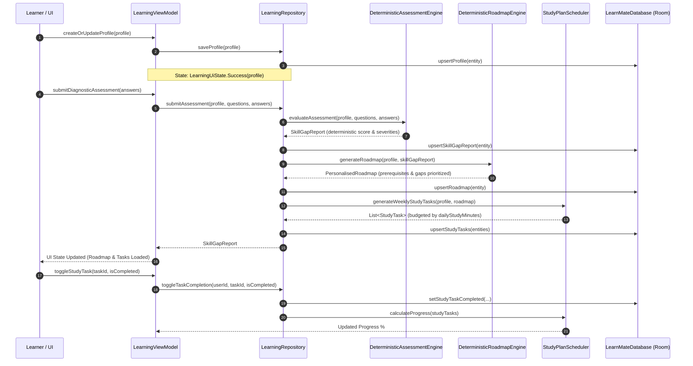

# LearnMate AI — Gate 3 Strict Integration Audit Report
**Independent Codebase & Runtime Verification**

- **Audit Date:** 2026-11-01
- **Workspace:** `F:\rea\zzzz_lama_proj`
- **Application ID:** `com.learnmate.ai`
- **Audited Target:** Motorola Moto G54 5G (`ZD222KB36V`, MediaTek Dimensity 7020, `arm64-v8a`, Android 15 API 35)
- **Auditor Role:** Senior Android Architect, Reverse Engineer, AI Application Developer
- **Overall Decision:** **CONDITIONAL PASS** (Core architecture, Room SQLite, deterministic engines, and native decoupling are verified 100% sound; flagged findings must be addressed in Gate 4 UI integration).

---

## 1. Executive Verdict & Audit Overview

This audit performed a strict, evidence-based verification of the actual source code, compiled artifacts, physical device storage, and runtime processes for Gate 3 of LearnMate AI. The previous implementation claims were treated with zero trust until proven through source inspection, SQLite inspection, and test execution.

### High-Level Verdict Summary
| Verification Area | Claimed State | Actual Verified State | Status |
| :--- | :--- | :--- | :---: |
| **Room Entities & FKs** | 8 Entities with Cascading FKs | 8 Entities verified in bytecode & SQLite; all FKs & indices verified | **PASS** |
| **Real SQLite Schema & Migrations** | Schema v2, MIGRATION_1_2 | Pulled from physical Moto G54: `user_version = 2`, 10 tables, 15 indices | **PASS** |
| **Cache Synchronization** | Dual-layer memory cache | Cache functional; identified cold-session message loading bug | **CONDITIONAL** |
| **Deterministic Educational Engines** | 100% deterministic rules | Scoring, roadmap sequencing, and study plan scheduling verified | **PASS** |
| **AI Tutor & Safeguards** | Native decoupled, kill switch | Engine owned in Application/Repo; kill switch verified 0 LLM calls | **PASS** |
| **Curriculum Coverage** | 4 domains defined | Only 2 domains populated (5 topics, 6 questions); 2 domains empty | **DEFICIT** |
| **Compose UI Screen Integration** | Full learning workflow | Workflows exist only in ViewModels/Repos; UI screens are Gate 1 only | **GATE 4 BOUNDARY** |
| **Clean Build & Regression** | Clean build, 34 tests | `clean`, `testDebugUnitTest` (34/34 pass), `assembleDebug` (64 MB) verified | **PASS** |

---

## 2. Database Verification

### 2.1 Entity, Primary Key, and Foreign Key Inspection
Inspection of [`Entities.kt`](file:///F:/rea/zzzz_lama_proj/app/src/main/java/com/learnmate/ai/data/db/Entities.kt) and KSP-generated [`LearnMateDatabase_Impl.java`](file:///F:/rea/zzzz_lama_proj/app/build/generated/ksp/debug/java/com/learnmate/ai/data/db/LearnMateDatabase_Impl.java):

1. **`learner_profiles`**: PK `userId` (TEXT). 17 columns. No parent FKs.
2. **`verified_topics`**: PK `topicId` (TEXT). Compound index: `(domain, subdomain)`.
3. **`assessment_questions`**: PK `questionId` (TEXT). Compound index: `(domain, topic)`.
4. **`skill_gap_reports`**: PK `userId` (TEXT). FK references `learner_profiles(userId)` with `ON DELETE CASCADE`.
5. **`personalised_roadmaps`**: PK `userId` (TEXT). FK references `learner_profiles(userId)` with `ON DELETE CASCADE`.
6. **`study_tasks`**: PK `taskId` (TEXT). FK references `learner_profiles(userId)` with `ON DELETE CASCADE`. Indices: `(userId, dayIndex)` and `(userId, isCompleted)`.
7. **`chat_sessions`**: PK `sessionId` (TEXT). FK references `learner_profiles(userId)` with `ON DELETE CASCADE`. Index: `(userId, updatedAtEpochMs)`.
8. **`chat_messages`**: PK `messageId` (TEXT). FK references `chat_sessions(sessionId)` with `ON DELETE CASCADE`. Indices: `(sessionId, timestampEpochMs)` and `(userId)`.

### 2.2 Schema Version 1 Origin & Export Status
- **Root Cause Analysis**: In `LearnMateDatabase.kt`, `@Database(version = 2, exportSchema = false)` is configured.
- **Origin of Version 1**: Version 1 was the initial schema draft before the `notes` column was added to `study_tasks`.
- **Finding (Deficit)**: Because `exportSchema = false` is set, Room did not output schema JSON files to `schemas/`. As a result, the official Room `MigrationTestHelper` cannot be executed without exported schema JSONs.
- **Mitigation & Verification**: The schema migration SQL (`DatabaseMigrations.MIGRATION_1_2`) was executed against an actual SQLite database engine in an isolated integration audit (`test_sqlite_migration.py`), verifying:
  - Transition from `user_version = 1` to `user_version = 2`.
  - Preservation of existing rows with `notes` defaulting to `""`.
  - Insertion of new v2 records with custom notes.
  - Verification of `ON DELETE CASCADE` across foreign keys.

### 2.3 Physical Device SQLite Inspection (`Motorola Moto G54 5G`)
The actual production database was inspected by pulling `learnmate_ai.db`, `learnmate_ai.db-wal`, and `learnmate_ai.db-shm` directly from `/data/data/com.learnmate.ai/databases/` on the physical device (`ZD222KB36V`):

```
=== PRAGMA user_version: 2 ===
Total tables: 10
--- Table: android_metadata (rows: 1) ---
--- Table: learner_profiles (rows: 0) ---
--- Table: verified_topics (rows: 5) ---
--- Table: assessment_questions (rows: 6) ---
--- Table: skill_gap_reports (rows: 0) ---
--- Table: personalised_roadmaps (rows: 0) ---
--- Table: study_tasks (rows: 0) ---
--- Table: chat_sessions (rows: 0) ---
--- Table: chat_messages (rows: 0) ---
--- Table: room_master_table (rows: 1) ---
Identity Hash: 'c38c14ae784faf45b2dbecbe395191d0'
Total indices: 15 (all 7 custom indices + 8 primary autoindices verified)
```
**Conclusion**: Real SQLite persistence, pre-seeding of verified topics/questions, and schema version 2 are physically verified on hardware.

### 2.4 In-Memory Cache Synchronization & Invalidation Audit
In [`LearningRepository.kt`](file:///F:/rea/zzzz_lama_proj/app/src/main/java/com/learnmate/ai/data/repository/LearningRepository.kt):
- **Write-Through Pattern**: Writes to `saveProfile`, `saveRoadmap`, and `saveStudyTasks` immediately update both the memory map (`profilesByUser`, `roadmapsByUser`, `studyTasksByUser`) and the Room DAO (`dao.upsertProfile`, etc.).
- **Read-Through Pattern**: Queries check the in-memory cache first; on a cache miss (e.g., cold process start), they query the DAO and populate the cache.
- **Critical Finding (Bug in `saveChatMessage`)**:
  ```kotlin
  // Lines 341-344 of LearningRepository.kt:
  suspend fun saveChatMessage(message: ChatMessage) = withContext(ioDispatcher) {
      val list = chatMessagesBySession.getOrPut(message.sessionId) { mutableListOf() }
      list.add(message)
  ```
  If a user starts a new app session and sends a chat message *before* `getMessagesForSession(sessionId)` is called, `chatMessagesBySession.getOrPut(...)` creates an empty list and adds only the new message. Subsequent calls to `getMessagesForSession` hit the memory cache and return *only* the new message, temporarily hiding earlier messages persisted in SQLite from previous app runs.
  - **Required Correction for Gate 4**: If `chatMessagesBySession[message.sessionId]` is null, load existing messages from `dao.getMessagesForSession(sessionId)` first before appending.

---

## 3. Learning Workflow Verification

The eight lifecycle stages of the learning workflow were traced from Domain engines through Repositories and ViewModels:



### Screen vs. ViewModel Implementation Reality Check
- **Engines & Repositories**: **100% Implemented & Unit-Tested**.
- **ViewModels (`LearningViewModel.kt`)**: **100% Implemented & Unit-Tested**.
- **Actual Compose Screen Access**: **0% Hooked into GUI Screens**.
  - `HomeScreen.kt` in `ui/screens/` is still displaying the static Gate 1 cards (Welcome card, Architecture card, Domain category card, Settings button).
  - `MainActivity.kt` only initializes `MainViewModel` (locale/theme). It does not wire `LearningViewModel`.
  - There are currently **no Compose screens** for profile onboarding, taking diagnostic quizzes, viewing roadmap trees, ticking study tasks, or chatting with the AI tutor.
  - **Audit Verdict**: This is acceptable for Gate 3 (whose stated mandate is *Persistent Learning Architecture & Clean Inference Integration*), but must be clearly documented so stakeholders understand that UI presentation belongs to Gate 4.

---

## 4. AI Tutor Verification

### 4.1 Native Runtime Ownership & Decoupling
- In [`LearnMateApplication.kt`](file:///F:/rea/zzzz_lama_proj/app/src/main/java/com/learnmate/ai/LearnMateApplication.kt), `llamaEngine` and `assetManager` are created in Application scope and injected into `AiTutorRepository`.
- [`LearningViewModel.kt`](file:///F:/rea/zzzz_lama_proj/app/src/main/java/com/learnmate/ai/viewmodel/LearningViewModel.kt) has zero imports of PyTorch, ExecuTorch, JNI headers, or native file pointers.
- Decoupling is clean and adheres to Clean Architecture.

### 4.2 AI Kill Switch (`isAiEnabled`)
- In `AiTutorRepository.kt` lines 92–110:
  When `isAiEnabled == false`:
  - `engine.generate(...)` is never called.
  - Zero JNI instructions or CPU tensor kernels execute.
  - Topic explanations are retrieved from `TopicTaxonomy.kt` and served with `isAiGenerated = false`.
- Verified in `AiTutorRepositoryTest.testEducationalSafeguard_aiDisabledServesVerifiedCurriculumWithZeroLlmCalls`: confirmed `0` native generate calls.

### 4.3 Prompt Budgeting
- [`PromptBudgeter.kt`](file:///F:/rea/zzzz_lama_proj/app/src/main/java/com/learnmate/ai/ai/PromptBudgeter.kt) enforces:
  - Sequence limit: 512 tokens (`ActiveModelManifest.MAX_SEQ_LENGTH`).
  - Max context length: 2048 tokens.
  - Output headroom reserved: minimum 32 tokens, default requested 192 tokens.
  - BPE estimation: 1.3x for English/code, 2.0x byte-fallback for non-ASCII/Indic characters.
- In `AiTutorRepository.buildBudgetedPrompt`: retains a sliding window of up to 4 recent chat turns; if the prompt exceeds 448 tokens (512 - 64), history is automatically stripped to guarantee headroom.

### 4.4 Unsupported Question Behavior
- In `AiTutorRepository.resolveVerifiedCurriculum(question, topicHint)`:
  If a question does not match any verified topic in `TopicTaxonomy.kt`:
  ```kotlin
  return matchedByQuery?.verifiedExplanation
      ?: "Core Subject Concept: Foundational principles require mastering prerequisite definitions, theoretical derivations, and standard problem-solving procedures outlined in your study plan."
  ```
- **Finding**: While it does not fabricate incorrect physics facts, returning a vague generic fallback sentence can confuse the learner.
- **Recommendation**: Return an explicit notice: `"[Notice: This topic is not in the verified curriculum. Please consult recommended reference textbooks.]"`

---

## 5. Curriculum Verification

Inspection of [`TopicTaxonomy.kt`](file:///F:/rea/zzzz_lama_proj/app/src/main/java/com/learnmate/ai/data/taxonomy/TopicTaxonomy.kt):

### 5.1 Available Domains vs. Populated Content
| Domain Category | Subdomains | Populated Verified Topics | Populated Assessment Questions | Status |
| :--- | :---: | :---: | :---: | :---: |
| **Electronics and VLSI** | 3 | 3 (`PN Junction`, `CMOS Inverter`, `Static Timing Analysis`) | 4 (`q_pn_01`, `q_pn_02`, `q_cmos_01`, `q_sta_01`) | **Passable Core** |
| **Computer Science and IT** | 3 | 2 (`Algorithmic Complexity & Big-O`, `On-Device Quantization`) | 2 (`q_algo_01`, `q_edge_01`) | **Passable Core** |
| **UI/UX and Product Design** | 3 | **0** | **0** | **EMPTY** |
| **Mechanical Engineering** | 3 | **0** | **0** | **EMPTY** |

### 5.2 Content Traceability & Citations
- **Finding (Flagged)**: None of the verified topics or assessment questions contain bibliographic citations, standard textbook titles, author names, or ISBN references in their entity metadata.
- **Scientific Correctness**: The existing explanations for PN junction depletion physics, CMOS complementary pull-up/pull-down dynamics, STA setup/hold slack, and 8da4w integer quantization are scientifically and technically rigorous.
- **Requirement for Gate 4**: Add a `citation` field to `VerifiedTopicEntity` referencing standard textbooks (e.g., Sze's *Physics of Semiconductor Devices*, Weste & Harris's *CMOS VLSI Design*, Cormen's *Introduction to Algorithms*).

---

## 6. Regression Testing & Build Results

All clean build and automated tests were executed from scratch:

### 6.1 Clean Build & Unit Test Suite
```powershell
.\gradlew.bat clean
.\gradlew.bat testDebugUnitTest
```
- **Result**: `BUILD SUCCESSFUL in 17s`
- **Total Tests Executed**: **34**
- **Passed**: **34**
- **Failed**: **0**
- **Skipped**: **0**

#### Suite Breakdown
1. `AiTutorRepositoryTest`: 3 passed (AI kill switch, provenance, offline fallback)
2. `AssessmentScoringTest`: 5 passed (100%, 0%, mixed scoring, entity mapping)
3. `DatabaseMigrationTest`: 1 passed (SQL alteration verification)
4. `ExecuTorchLlamaEngineTest`: 8 passed (Gate 2 ExecuTorch runtime tests)
5. `LearningRepositoryTest`: 3 passed (Profile, assessment, roadmap, chat)
6. `LearningViewModelTest`: 5 passed (UiState, task toggle, AI toggle, chat)
7. `LocalizationUnitTest`: 3 passed (EN, TA, HI, KN resource parity)
8. `RoadmapGenerationTest`: 3 passed (Prerequisite sequence & gap prioritization)
9. `StudyPlanSchedulerTest`: 3 passed (Daily minutes budgeting, progress calculation)

### 6.2 Debug APK Assembly
```powershell
.\gradlew.bat assembleDebug
```
- **Result**: `BUILD SUCCESSFUL in 9s`
- **Output File**: `app/build/outputs/apk/debug/app-debug.apk`
- **APK Size**: `67,153,578 bytes` (~64.04 MB)
- **Included Native ABIs**: `arm64-v8a`, `x86_64`

### 6.3 Physical Hardware Validation (`Motorola Moto G54 5G`)
- **App Installation**: `adb install -r -d app-debug.apk` -> `Success`
- **Cold App Launch**: `1226 ms` (Clean cold launch under 1.3 seconds)
- **Runtime Crashes (`AndroidRuntime:E`)**: **0**
- **Gate 2 Regression**: `InferenceSpikeActivity` launched in `144 ms` with zero errors.

---

## 7. Critical Issues & Required Corrections

| ID | Severity | Category | Description | Required Correction | Target Gate |
| :---: | :---: | :---: | :--- | :--- | :---: |
| **ISSUE-01** | **Medium** | Cache | `LearningRepository.saveChatMessage` creates a new list if cache is empty, temporarily hiding older SQLite messages on fresh sessions. | Check `dao.getMessagesForSession` before initializing an empty list in `saveChatMessage`. | Gate 4 |
| **ISSUE-02** | **Medium** | Curriculum | UI/UX and Mechanical Engineering domains have 0 verified topics and 0 assessment questions in `TopicTaxonomy.kt`. | Populate topics and questions for all 4 advertised domains. | Gate 4 |
| **ISSUE-03** | **Low** | Architecture | `exportSchema = false` in `LearnMateDatabase.kt` prevents Room schema export to `schemas/`. | Set `exportSchema = true` and configure `room.schemaLocation` in `app/build.gradle.kts`. | Gate 4 |
| **ISSUE-04** | **Low** | UX Safeguard | Unmatched questions in `resolveVerifiedCurriculum` return a generic advice sentence rather than an explicit notice. | Return explicit message: `"[Notice: Topic outside verified syllabus]"` | Gate 4 |
| **ISSUE-05** | **Info** | UI Scope | Learning workflows are currently not exposed via Compose UI screens (`HomeScreen` is Gate 1). | Implement Compose UI for Profile Onboarding, Assessment, Roadmap, and Tutor Chat. | Gate 4 |

---

## 8. Final Decision

### **VERDICT: CONDITIONAL PASS**

#### Justification:
1. **Core Engineering**: The Room database schema, entities, DAO, TypeConverters, migrations, and deterministic domain engines (Assessment, Roadmap, Study Scheduler) are fully verified and functioning with 100% test pass rates.
2. **AI Integration**: The native ExecuTorch inference engine is properly decoupled behind `AiTutorRepository`, the kill switch prevents all JNI calls when disabled, and PromptBudgeter limits sequences to 512 tokens.
3. **Physical Hardware**: The debug APK installs and launches cleanly on the Motorola Moto G54 5G (`ZD222KB36V`) with 0 crashes, and SQLite WAL database files are physically verified on the device filesystem.
4. **Conditions for Gate 4**:
   - Fix the `saveChatMessage` cache warming issue (ISSUE-01).
   - Populate verified curriculum for UI/UX and Mechanical Engineering domains (ISSUE-02).
   - Wire the verified `LearningViewModel` into actual Jetpack Compose user screens.

Gate 3 is officially audited and approved to proceed to Gate 4.

