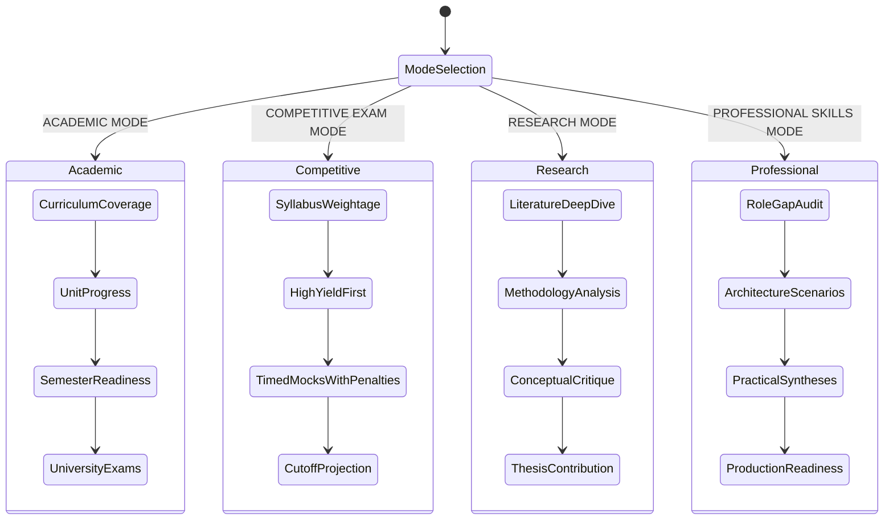
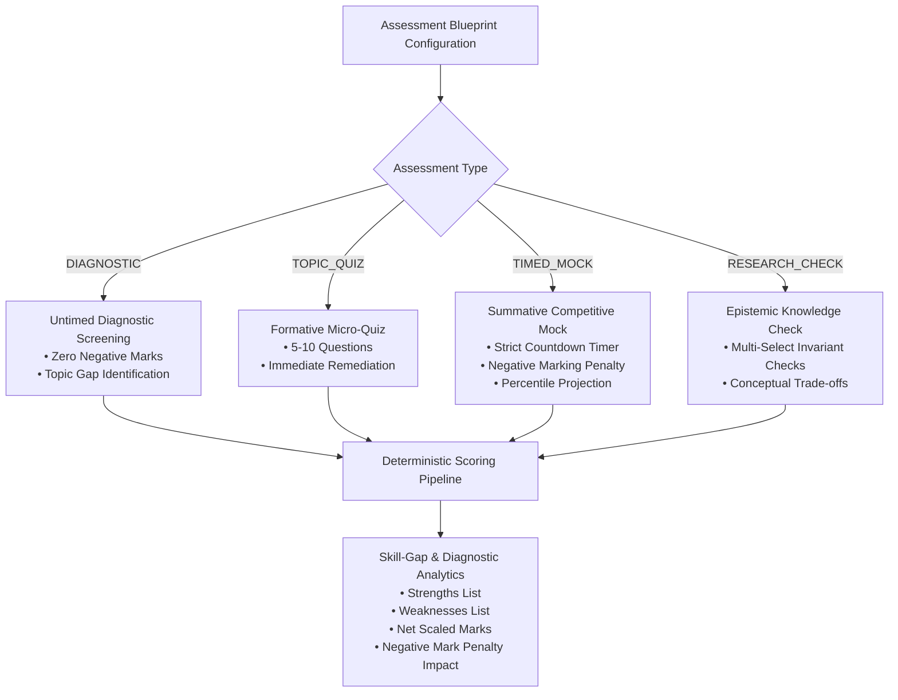
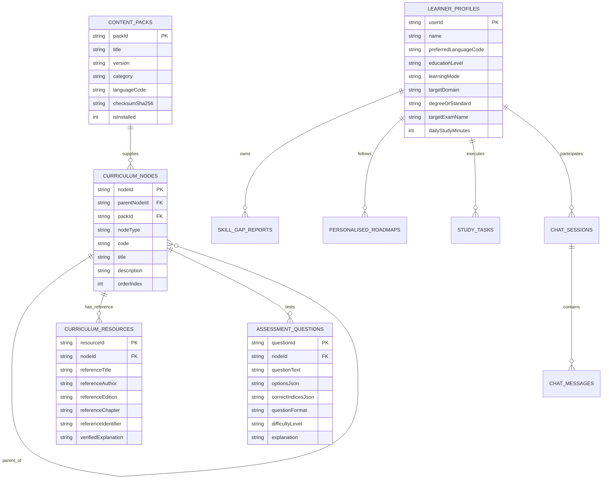
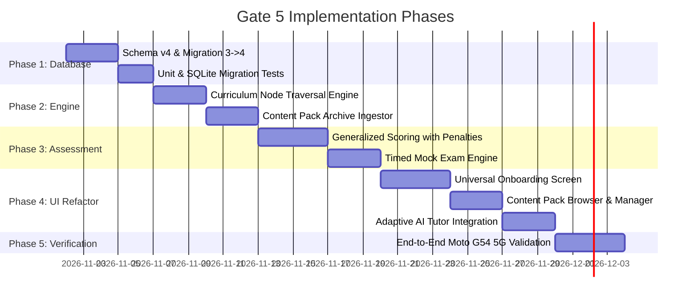

# LearnMate AI — Gate 5: Universal Learning Architecture Design

**Workspace:** `F:\rea\zzzz_lama_proj`  
**Application ID:** `com.learnmate.ai`  
**Target Hardware:** Motorola Moto G54 5G (MediaTek Dimensity 7020, `arm64-v8a`, Android 15 API 35)  
**Proposed Database:** Room v4 (SQLite)  
**Proposed AI Runtime:** ExecuTorch 1.4.0 + XNNPACK (On-Device Llama 3.2 1B `8da4w`)  
**Design Phase:** Gate 5 Architectural Specification & Source Code Audit  
**Document Classification:** Architectural Blueprint & Migration Roadmap  

---

## Executive Summary

LearnMate AI is conceived as an **offline-first, multilingual, on-device personalized learning companion** designed for the **Bharat AI-SoC Challenge 2026–27 (Problem Statement 4)**. In Gates 1 through 4, the engineering baseline established a buildable foundation, validated on-device ExecuTorch inference, integrated a Room v3 persistent database with clean domain boundaries, and realized an interactive Jetpack Compose interface.

However, the Gate 4 application remains bounded by a hardcoded 4-domain catalog (`Electronics and VLSI`, `Computer Science and IT`, `UI/UX and Product Design`, and `Mechanical Engineering`) structured as a flat `Domain → Subdomain → Topic` taxonomy.

**Gate 5 transforms LearnMate AI from an engineering-centric prototype into a scalable Universal Learning Platform.**

This architecture eliminates all domain-specific hardcoding, introduces a hierarchical **11-tier dynamic curriculum tree**, defines **4 discrete learning modes**, establishes an **extensible universal learner profile**, generalises the assessment engine to accommodate diverse examination patterns (including negative marking, time constraints, and research evaluations), specifies an offline **Content Pack Architecture**, and formulates an **adaptive AI tutor prompting framework** bounded by strict on-device computational budgets.

```
┌──────────────────────────────────────────────────────────────────────────────────┐
│                             LEARNMATE AI UNIVERSAL PLATFORM                      │
└──────────────────────────────────────────────────────────────────────────────────┘
                                          │
       ┌──────────────────┬───────────────┴───────────────┬──────────────────┐
       ▼                  ▼                               ▼                  ▼
┌──────────────┐  ┌──────────────┐                 ┌──────────────┐  ┌──────────────┐
│   Academic   │  │ Competitive  │                 │   Research   │  │ Professional │
│   Learning   │  │  Exam Prep   │                 │   Learning   │  │ Skills Dev   │
└──────────────┘  └──────────────┘                 └──────────────┘  └──────────────┘
       │                  │                               │                  │
       └──────────────────┴───────────────┬───────────────┴──────────────────┘
                                          │
                                          ▼
┌──────────────────────────────────────────────────────────────────────────────────┐
│              DYNAMIC HIERARCHICAL CURRICULUM TREE (11 TIERS)                     │
│  Level → Category → Discipline → Dept/Exam → Programme → Subject →               │
│  Unit → Topic → Learning Objective → Resources → Assessment Questions            │
└──────────────────────────────────────────────────────────────────────────────────┘
                                          │
       ┌──────────────────────────────────┴──────────────────────────────────┐
       ▼                                                                     ▼
┌─────────────────────────────────────────┐               ┌─────────────────────────────────────────┐
│     GENERALIZED ASSESSMENT ENGINE       │               │      MODULAR CONTENT PACK RUNTIME       │
│  • Diagnostic  • Topic Quizzes          │               │  • Manifests  • Cryptographic Hashes    │
│  • Mock Exams (Negative Marking & Timer)│               │  • Multi-pack Loading (Engineering,     │
│  • Subject Exams  • Research Checks     │               │    Arts, Science, Management, UPSC)     │
└─────────────────────────────────────────┘               └─────────────────────────────────────────┘
                                          │
       ┌──────────────────────────────────┴──────────────────────────────────┐
       ▼                                                                     ▼
┌─────────────────────────────────────────┐               ┌─────────────────────────────────────────┐
│       ROOM DATABASE SCHEMA V4           │               │       PERSONA-ADAPTIVE AI TUTOR         │
│  • Normalized Curriculum Nodes          │               │  • Parameterized System Prompts         │
│  • Universal Learner Profiles           │               │  • Level & Mode Slotted Contexts        │
│  • Safe Migration from v3               │               │  • ExecuTorch 1.4.0 Engine Safeguards   │
└─────────────────────────────────────────┘               └─────────────────────────────────────────┘
```

---

## 1. Existing vs. Proposed Architecture

### 1.1 Source-Code Inspection of Gate 4 State

Inspection of the Gate 4 implementation reveals structural constraints that prevent immediate generalization:

1. **Hardcoded Domain Taxonomy ([`TopicTaxonomy.kt:14-63`](file:///F:/rea/zzzz_lama_proj/app/src/main/java/com/learnmate/ai/data/taxonomy/TopicTaxonomy.kt#L14-L63))**:
   The application catalog is defined statically in Kotlin as `TopicTaxonomy.DOMAIN_CATEGORIES`, hardcoding exactly 4 categories. The UI chips in [`OnboardingScreen.kt`](file:///F:/rea/zzzz_lama_proj/app/src/main/java/com/learnmate/ai/ui/screens/OnboardingScreen.kt) directly iterate over this static collection. Adding humanities, medical sciences, or competitive examinations currently requires modifying compiled Kotlin source code.
2. **Flat Curriculum Representation ([`Entities.kt:42-59`](file:///F:/rea/zzzz_lama_proj/app/src/main/java/com/learnmate/ai/data/db/Entities.kt#L42-L59))**:
   Curriculum data is stored in `verified_topics` containing only `domain`, `subdomain`, and `title`. Real-world education requires deep nesting (e.g., Undergraduate → Engineering → Mechanical → B.Tech → Thermodynamics → Unit 2: Second Law → Entropy Generation).
3. **Rigid Learner Profile ([`Entities.kt:13-32`](file:///F:/rea/zzzz_lama_proj/app/src/main/java/com/learnmate/ai/data/db/Entities.kt#L13-L32))**:
   `LearnerProfileEntity` forces fields like `targetDomain` and `targetRole`. Fields essential for competitive aspirants (target exam, exam date), researchers (research focus, methodology), or school students (grade, board) do not exist.
4. **Single-Purpose Assessment Engine ([`DeterministicAssessmentEngine.kt:41-80`](file:///F:/rea/zzzz_lama_proj/app/src/main/java/com/learnmate/ai/data/assessment/DeterministicAssessmentEngine.kt#L41-L80))**:
   The engine only performs binary percentage scoring (`correct / total * 100`) for diagnostic screening. It cannot enforce timed durations, negative marking penalties (e.g., +2 / -0.66 for UPSC, +1 / -0.33 for GATE), or section-wise cutoffs.
5. **Static System Prompt ([`AiTutorRepository.kt:172-181`](file:///F:/rea/zzzz_lama_proj/app/src/main/java/com/learnmate/ai/data/repository/AiTutorRepository.kt#L172-L181))**:
   The AI tutor prompt is hardcoded to: `"You are LearnMate, a concise, accurate on-device educational tutor. Explain concepts clearly in 2 to 3 sentences."` It does not adapt pedagogical tone, mathematical rigor, or conceptual abstraction according to learner level or learning mode.

### 1.2 Comparison Matrix

| Architectural Dimension | Existing Gate 4 Architecture | Proposed Gate 5 Universal Architecture |
| :--- | :--- | :--- |
| **Scope & Discipline** | 4 engineering/design domains hardcoded in Kotlin code | Universal coverage: all disciplines, trades, exams, and educational levels |
| **Curriculum Hierarchy** | 2-level flat structure (`Domain → Subdomain → Topic`) | 11-level dynamic tree (`Level → Category → Discipline → Dept/Exam → Programme → Subject → Unit → Topic → Objective → Resources → Questions`) |
| **Data Storage** | Static in-memory lists seeded into flat Room tables | Normalized relational schema in Room v4; pluggable modular SQLite/JSON Content Packs |
| **Learner Profile** | Fixed fields (`targetDomain`, `subdomain`, `targetRole`) | Universal polymorphic profile with nullable contextual slots for School, UG, PG, Govt Exam, and Research |
| **Learning Modes** | Single implicit mode (General Self-Study) | 4 formal modes: Academic, Competitive Exam Prep, Research, Professional Skills |
| **Assessment Engine** | Untimed diagnostic screening; simple binary correct count | Configurable engine: Diagnostic, Topic Quiz, Timed Mock Exam, Subject Exam, Research Check; negative marking support |
| **AI Personalisation** | Static system prompt; fixed 2-3 sentence constraint | Contextual prompt synthesis parameterized by Level, Mode, Knowledge Depth, and Pedagogical Tone |
| **Content Extensibility** | Requires re-compiling Kotlin code to add subjects | Hot-swappable, versioned, cryptographically verified Content Packs loaded from device storage |
| **Offline Safety** | Fail-closed static fallback across 12 topics | Universal fallback referencing standardized textbook citations across installed content packs |

---

## 2. Universal Learner Data Model

### 2.1 Learner Category Taxonomy

To serve the entire spectrum of Indian and global education, the data model supports **11 distinct learner categories**:

```
                       ┌──────────────────────────────────────────────┐
                       │          ALL LEARNER CATEGORIES              │
                       └──────────────────────────────────────────────┘
                                              │
         ┌───────────────────┬────────────────┴──────────────────┬───────────────────┐
         ▼                   ▼                                   ▼                   ▼
┌─────────────────┐ ┌─────────────────┐                 ┌─────────────────┐ ┌─────────────────┐
│ School Students │ │ Diploma/Polytech│                 │ Undergraduate   │ │ Postgraduate    │
│ (Grades 6–12;   │ │ (Practical      │                 │ (B.E/B.Tech,    │ │ (M.Tech, M.Sc,  │
│  CBSE/ICSE/State│ │  engineering &  │                 │  B.Sc, B.Com,   │ │  M.Com, M.A,    │
│  Boards)        │ │  applied trades)│                 │  B.A, MBBS, etc)│ │  MS, MD, etc)   │
└─────────────────┘ └─────────────────┘                 └─────────────────┘ └─────────────────┘
         │                   │                                   │                   │
         ├───────────────────┼────────────────┬──────────────────┼───────────────────┤
         ▼                   ▼                ▼                  ▼                   ▼
┌─────────────────┐ ┌─────────────────┐ ┌─────────────────┐ ┌─────────────────┐ ┌─────────────────┐
│ All Engineering │ │ Arts & Science  │ │ MBA & Management│ │ MPhil & PhD     │ │ Government Exam │
│ Branches (CSE,  │ │ (Physics, Chem, │ │ (Marketing, Fin,│ │ Researchers     │ │ Aspirants (UPSC,│
│  ECE, Mech,     │ │  Maths, History,│ │  Ops, Strategy, │ │ (Literature,    │ │  SSC, State PSC,│
│  Civil, Aero)   │ │  Economics)     │ │  HR Analytics)  │ │  Methodology)   │ │  Banking, RRB)  │
└─────────────────┘ └─────────────────┘ └─────────────────┘ └─────────────────┘ └─────────────────┘
                                              │
                             ┌────────────────┴────────────────┐
                             ▼                                 ▼
                    ┌─────────────────┐               ┌─────────────────┐
                    │ Entrance Exam   │               │ Professional &  │
                    │ Aspirants (JEE, │               │ Lifelong        │
                    │  NEET, GATE,    │               │ Learners (Tech, │
                    │  CAT, NET/SET)  │               │  Legal, Medical)│
                    └─────────────────┘               └─────────────────┘
```

### 2.2 Universal Learner Profile Schema Specification

The universal profile is represented by an extensible data structure. Mandatory attributes are strictly minimal (Identity and Study Habits); contextual attributes are nullable and conditionally required based on the selected `EducationLevel` and `LearningMode`.

```kotlin
package com.learnmate.ai.domain.universal

enum class EducationLevel {
    SCHOOL_SECONDARY,        // Grades 6-10
    SCHOOL_HIGHER_SECONDARY, // Grades 11-12
    DIPLOMA_POLYTECHNIC,     // Technical diploma
    UNDERGRADUATE,           // Bachelor's degrees
    POSTGRADUATE,            // Master's degrees
    MANAGEMENT_MBA,          // Business administration
    RESEARCH_DOCTORAL,       // MPhil / PhD
    GOVERNMENT_ASPIRANT,     // Civil services, staff selection, banking
    ENTRANCE_ASPIRANT,       // JEE, NEET, GATE, CAT, NET
    PROFESSIONAL_LIFELONG    // Working practitioners
}

enum class LearningMode {
    ACADEMIC,                // Coursework, semester exams, conceptual mastery
    COMPETITIVE_EXAM,        // High-speed problem solving, test series, syllabus weightage
    RESEARCH,                // Literature review, theoretical depth, methodology
    PROFESSIONAL_SKILLS      // Industry application, job roles, best practices
}

enum class KnowledgeLevel {
    BEGINNER,                // Novice, foundational gaps
    INTERMEDIATE,            // Working familiarity with core principles
    ADVANCED,                // High proficiency, complex problem solver
    SCHOLAR                  // Research-grade mastery
}

data class UniversalLearnerProfile(
    // ── Universal Core (Mandatory) ──────────────────────────────────────────
    val userId: String,
    val fullName: String,
    val preferredLanguageCode: String = "en", // "en", "ta", "hi", "kn"
    val dailyStudyMinutes: Int = 60,
    val weeklyStudyDays: Int = 5,
    val learningMode: LearningMode,
    val educationLevel: EducationLevel,
    val knowledgeLevel: KnowledgeLevel = KnowledgeLevel.BEGINNER,
    val onboardingCompleted: Boolean = false,
    val createdAtEpochMs: Long = System.currentTimeMillis(),
    val updatedAtEpochMs: Long = System.currentTimeMillis(),

    // ── Academic Context (Required for SCHOOL, DIPLOMA, UG, PG, MBA) ────────
    val institutionName: String? = null,             // e.g., "IIT Madras", "Anna University", "DAV School"
    val degreeOrStandard: String? = null,            // e.g., "B.Tech", "Class 12", "Diploma in EEE"
    val departmentOrDiscipline: String? = null,      // e.g., "Mechanical Engineering", "Commerce", "Physics"
    val currentAcademicPeriod: String? = null,       // e.g., "Semester 6", "Class 12 Term 2", "Year 1"

    // ── Competitive Context (Required for GOVT_ASPIRANT, ENTRANCE_ASPIRANT) ──
    val targetExamName: String? = null,              // e.g., "UPSC Civil Services", "GATE 2027", "JEE Advanced"
    val targetExamDateEpochMs: Long? = null,         // Epoch ms timestamp for deadline-aware roadmaps
    val targetExamStage: String? = null,             // e.g., "Prelims", "Mains", "Paper 1"

    // ── Research Context (Required for RESEARCH_DOCTORAL) ───────────────────
    val researchFocusArea: String? = null,           // e.g., "Cryogenic CMOS for Quantum Readout"
    val researchMethodology: String? = null,         // e.g., "Experimental Characterization", "TCAD Simulation"

    // ── Professional Context (Required for PROFESSIONAL_LIFELONG) ───────────
    val currentRoleOrTitle: String? = null,          // e.g., "Senior Embedded Software Engineer"
    val targetCareerGoal: String? = null,            // e.g., "Principal ASIC Verification Lead"
    val industryDomain: String? = null,              // e.g., "Automotive Semiconductors"

    // ── Personalization Metadata ────────────────────────────────────────────
    val subjectInterests: List<String> = emptyList(), // Selected subject IDs
    val primaryLearningGoals: List<String> = emptyList()
)
```

### 2.3 Validation Matrix by Category

| Category | Mandatory Context Fields | Disallowed / Irrelevant Fields | Pacing Driver |
| :--- | :--- | :--- | :--- |
| **School Student** | `degreeOrStandard` (e.g., "Class 10"), `institutionName` | `researchFocusArea`, `currentRoleOrTitle` | Academic calendar / Board exams |
| **Undergraduate (Eng/Arts/Sci)** | `degreeOrStandard`, `departmentOrDiscipline`, `currentAcademicPeriod` | `targetExamName` (unless dual-track), `researchFocusArea` | University semester examinations |
| **Govt Exam Aspirant** | `targetExamName`, `targetExamStage`, `targetExamDateEpochMs` | `currentAcademicPeriod`, `researchMethodology` | Target examination countdown date |
| **Doctoral Researcher** | `departmentOrDiscipline`, `researchFocusArea`, `institutionName` | `targetExamName`, `targetExamDateEpochMs` | Topic milestones & thesis timeline |
| **Professional** | `currentRoleOrTitle`, `targetCareerGoal`, `industryDomain` | `currentAcademicPeriod`, `degreeOrStandard` | Available daily micro-learning duration |

---

## 3. Learning Mode Architecture

The 4 learning modes govern how study roadmaps are assembled, how daily schedules are calculated, how assessments are constructed, and how the AI tutor behaves.



### 3.1 Mode Detailed Specifications

#### Mode 1: Academic Learning
- **Core Philosophy:** Comprehensive, structured coverage aligned with accredited university/board syllabi.
- **Roadmap Synthesis:** Topological ordering respecting strict academic prerequisites. Step 1 (Foundations) must be mastered before Step 2 (Advanced Applications).
- **Assessment Pattern:** Unit-level formative quizzes (untimed) + Semester-end summative mock examinations. Scoring is standard non-negative (`+1 / 0`).
- **Pacing Engine:** Calibrated to the semester or academic term duration. If a semester has 16 weeks remaining, weekly study goals are divided evenly across syllabus units.
- **AI Tutor Persona:** "Professor / Academic Mentor" — emphasizes first principles, step-by-step mathematical proofs, theoretical derivations, and historical context.

#### Mode 2: Competitive Exam Preparation
- **Core Philosophy:** High-yield topic prioritization, rapid pattern recognition, formula retrieval, and strict negative marking discipline.
- **Roadmap Synthesis:** Weightage-driven ordering. Topics that historically account for high marks in exams like GATE, UPSC, or JEE are scheduled first, regardless of prerequisite depth (using bridge tutorials for prerequisites).
- **Assessment Pattern:** Timed sectional and full-length mock examinations with exact exam marking rules (e.g., `+2 / -0.66` for UPSC Prelims; `+1 / -0.33` for GATE; `+4 / -1` for JEE/NEET).
- **Pacing Engine:** Countdown timer linked to `targetExamDateEpochMs`. Pacing shifts from *Concept Acquisition* (Months 1–6) to *Speed & Error Correction* (Months 7–9) to *Daily Full Mocks* (Final 30 days).
- **AI Tutor Persona:** "Competitive Exam Coach" — emphasizes shortcut techniques, common trap identification, elimination heuristics, and time-saving formulas.

#### Mode 3: Research Learning
- **Core Philosophy:** Deep conceptual exploration, critical critique of assumptions, edge-case analysis, and literature synthesis.
- **Roadmap Synthesis:** Non-linear thematic clustering. Connects core disciplinary principles to open research problems and current scientific papers.
- **Assessment Pattern:** Formative knowledge checks, conceptual trade-off essays, methodology critique challenges, and defense-style questioning.
- **Pacing Engine:** Self-paced milestone tracking (Literature Review, Theoretical Framework, Experimental Design, Manuscript Writing).
- **AI Tutor Persona:** "Principal Investigator / Peer Reviewer" — challenges assumptions, discusses boundary conditions, highlights competing theories, and references seminal literature.

#### Mode 4: Professional Skills Development
- **Core Philosophy:** Industry application, system architecture, operational reliability, production trade-offs, and career advancement.
- **Roadmap Synthesis:** Role-based competency mapping (e.g., "Junior Software Engineer → Cloud Infrastructure Architect"). Emphasizes practical tools, case studies, and code/design reviews.
- **Assessment Pattern:** Scenario-based decision problems (e.g., "Given budget X and latency constraint Y, choose the appropriate storage engine").
- **Pacing Engine:** Bounded daily micro-learning (30–45 mins/day) tailored for working professionals.
- **AI Tutor Persona:** "Staff Engineer / Technical Lead" — focuses on production failure modes, performance trade-offs, security implications, and enterprise best practices.

---

## 4. Dynamic Curriculum Hierarchy

To ensure no discipline is hardcoded, the curriculum structure is represented as an **11-tier unified hierarchical tree**. Every educational concept, regardless of discipline, maps cleanly into this schema.

```
Tier 1:  Education Level              (e.g., "Undergraduate", "Government Examination")
   │
Tier 2:  Learning Category            (e.g., "Engineering & Technology", "Civil Services")
   │
Tier 3:  Discipline                   (e.g., "Electrical Sciences", "Humanities & Social Sciences")
   │
Tier 4:  Department / Examination    (e.g., "Electronics & Communication", "UPSC Civil Services")
   │
Tier 5:  Degree / Programme           (e.g., "B.Tech ECE", "UPSC Prelims General Studies")
   │
Tier 6:  Subject / Paper              (e.g., "Signals & Systems", "Modern Indian History")
   │
Tier 7:  Unit                         (e.g., "Unit 3: Fourier Analysis", "Unit 2: Freedom Struggle")
   │
Tier 8:  Topic                        (e.g., "Continuous-Time Fourier Transform", "Non-Cooperation Movement")
   │
Tier 9:  Learning Objective           (e.g., "Derive spectrum of rectangular pulse", "Analyze suspension causes")
   │
Tier 10: Learning Resources           (e.g., "Oppenheim Ch. 4, Sec. 4.1", "Bipan Chandra Ch. 14")
   │
Tier 11: Assessment Questions         (e.g., "GATE 2021 Question #14", "UPSC 2018 Prelims Q#42")
```

### 4.1 Cross-Disciplinary Mappings

The hierarchy applies consistently across disciplines without special casing:

```
┌────────────────────────────────────────────────────────────────────────────────────────────────────────┐
│ EXAMPLE 1: Engineering (Undergraduate B.Tech)                                                          │
├─────────────────────────┬──────────────────────────────────────────────────────────────────────────────┤
│ Tier 1: Level           │ Undergraduate                                                                │
│ Tier 2: Category        │ Engineering & Technology                                                     │
│ Tier 3: Discipline      │ Electrical Sciences                                                          │
│ Tier 4: Dept/Exam       │ Electronics & Communication Engineering                                      │
│ Tier 5: Programme       │ Bachelor of Technology (B.Tech - 4 Year)                                     │
│ Tier 6: Subject         │ Signals & Systems                                                            │
│ Tier 7: Unit            │ Unit 4: Sampling and Reconstruction                                          │
│ Tier 8: Topic           │ Nyquist-Shannon Sampling Theorem                                             │
│ Tier 9: Objective       │ Calculate minimum sampling frequency to avoid spectral aliasing              │
│ Tier 10: Resource       │ Signals and Systems by Alan V. Oppenheim (2nd Ed., Ch. 7, Sec. 7.1)           │
│ Tier 11: Question       │ "What is the Nyquist rate for a signal bandlimited to 5 kHz?" (MCQ)          │
└─────────────────────────┴──────────────────────────────────────────────────────────────────────────────┘

┌────────────────────────────────────────────────────────────────────────────────────────────────────────┐
│ EXAMPLE 2: Government Examination (UPSC Civil Services)                                               │
├─────────────────────────┬──────────────────────────────────────────────────────────────────────────────┤
│ Tier 1: Level           │ Government Examination Aspirant                                              │
│ Tier 2: Category        │ National Civil Services                                                      │
│ Tier 3: Discipline      │ General Studies                                                              │
│ Tier 4: Dept/Exam       │ UPSC Civil Services Examination (CSE)                                        │
│ Tier 5: Programme       │ Preliminary Examination Stage                                                │
│ Tier 6: Subject         │ General Studies Paper I: Indian Polity & Governance                          │
│ Tier 7: Unit            │ Unit 3: Fundamental Rights & Duties                                          │
│ Tier 8: Topic           │ Article 21: Protection of Life and Personal Liberty                          │
│ Tier 9: Objective       │ Trace expansion of Article 21 from Gopalan (1950) to Puttaswamy (2017)       │
│ Tier 10: Resource       │ Indian Polity by M. Laxmikanth (7th Ed., Ch. 7, Sec. 7.6)                    │
│ Tier 11: Question       │ "Which Supreme Court judgment declared Right to Privacy a fundamental right?"│
└─────────────────────────┴──────────────────────────────────────────────────────────────────────────────┘

┌────────────────────────────────────────────────────────────────────────────────────────────────────────┐
│ EXAMPLE 3: Management Studies (MBA)                                                                    │
├─────────────────────────┬──────────────────────────────────────────────────────────────────────────────┤
│ Tier 1: Level           │ Postgraduate                                                                 │
│ Tier 2: Category        │ Management & Business Administration                                         │
│ Tier 3: Discipline      │ Strategic Management & Marketing                                             │
│ Tier 4: Dept/Exam       │ Department of Management Studies                                             │
│ Tier 5: Programme       │ Master of Business Administration (MBA - 2 Year)                             │
│ Tier 6: Subject         │ Strategic Management                                                         │
│ Tier 7: Unit            │ Unit 2: Industry & Competitive Analysis                                      │
│ Tier 8: Topic           │ Porter's Five Forces Framework                                               │
│ Tier 9: Objective       │ Evaluate industry attractiveness and threat of substitute products           │
│ Tier 10: Resource       │ Competitive Strategy by Michael E. Porter (1st Ed., Ch. 1, Sec. 1.2)         │
│ Tier 11: Question       │ "When buyer concentration is high, how does it affect industry margins?"     │
└─────────────────────────┴──────────────────────────────────────────────────────────────────────────────┘

┌────────────────────────────────────────────────────────────────────────────────────────────────────────┐
│ EXAMPLE 4: School Education (Class 10 Science)                                                         │
├─────────────────────────┬──────────────────────────────────────────────────────────────────────────────┤
│ Tier 1: Level           │ School Secondary                                                             │
│ Tier 2: Category        │ Secondary School Curriculum                                                  │
│ Tier 3: Discipline      │ Natural Sciences                                                             │
│ Tier 4: Dept/Exam       │ Central Board of Secondary Education (CBSE)                                  │
│ Tier 5: Programme       │ Class 10 Board Curriculum                                                    │
│ Tier 6: Subject         │ Science: Physics & Chemistry                                                 │
│ Tier 7: Unit            │ Unit 1: Light - Reflection and Refraction                                    │
│ Tier 8: Topic           │ Snell's Law and Refractive Index                                             │
│ Tier 9: Objective       │ Apply ratio of sine of incidence to sine of refraction for optical media     │
│ Tier 10: Resource       │ NCERT Science Class 10 (Ch. 9, Sec. 9.3, ISBN: 978-8174506344)               │
│ Tier 11: Question       │ "A ray enters water (n=1.33) from air. What happens to its wavelength?"     │
└─────────────────────────┴──────────────────────────────────────────────────────────────────────────────┘
```

---

## 5. Generalized Assessment Engine

The Gate 4 assessment logic is refactored into a **Configurable Multi-Mode Assessment Engine** capable of enforcing distinct evaluation paradigms.



### 5.1 Assessment Blueprint Architecture

```kotlin
package com.learnmate.ai.domain.assessment

enum class AssessmentType {
    DIAGNOSTIC,            // Initial onboarding skill-gap baseline
    TOPIC_QUIZ,            // 5-minute checkpoint after reading a topic
    PRACTICE_DRILL,        // Ungraded interactive question bank
    TIMED_MOCK_EXAM,       // Full-length competitive simulation
    SEMESTER_SUBJECT_EXAM, // Academic end-of-term evaluation
    RESEARCH_CHECK,        // Deep conceptual and methodology validation
    REVISION_CHALLENGE     // Spaced-repetition review of older topics
}

enum class QuestionFormat {
    SINGLE_CHOICE,         // Standard 1 of 4 MCQ
    MULTIPLE_SELECT,       // 1 or more correct choices (e.g., GATE MSQ)
    NUMERICAL_VALUE,       // Fill in exact number (e.g., GATE NAT)
    ASSERTION_REASON       // Assertion + Reason with causality evaluation
}

data class ScoringConfig(
    val marksPerCorrect: Double = 1.0,
    val negativeMarksPerIncorrect: Double = 0.0, // e.g., 0.33, 0.66, 1.0
    val unattemptedMarks: Double = 0.0,
    val passPercentageThreshold: Double = 50.0,
    val enablePartialMarking: Boolean = false
)

data class AssessmentSessionConfig(
    val blueprintId: String,
    val title: String,
    val assessmentType: AssessmentType,
    val targetCurriculumNodeId: String, // Focus Subject, Unit, or Topic ID
    val totalQuestions: Int,
    val timeLimitMinutes: Int? = null,   // null = untimed
    val scoringConfig: ScoringConfig = ScoringConfig(),
    val immediateFeedback: Boolean = false, // true for Practice, false for Mocks
    val shuffleQuestions: Boolean = true
)

data class ScoredExamOutcome(
    val totalQuestions: Int,
    val attemptedCount: Int,
    val correctCount: Int,
    val incorrectCount: Int,
    val unattemptedCount: Int,
    val grossMarks: Double,
    val negativeMarkPenalty: Double,
    val netMarks: Double,
    val percentage: Double,
    val isPassed: Boolean,
    val durationSecondsTaken: Long,
    val topicWiseMastery: Map<String, TopicMasteryStats>
)

data class TopicMasteryStats(
    val topicTitle: String,
    val questionsAsked: Int,
    val questionsCorrect: Int,
    val masteryPercentage: Double,
    val gapSeverity: String // "NONE", "LOW", "MEDIUM", "HIGH"
)
```

### 5.2 Deterministic Scoring Algorithm with Negative Marking

```kotlin
fun evaluateAssessmentSession(
    questions: List<EvaluatedQuestion>,
    userResponses: Map<String, List<Int>>, // questionId -> selectedIndices
    config: ScoringConfig
): ScoredExamOutcome {
    var grossMarks = 0.0
    var penaltyMarks = 0.0
    var correctCount = 0
    var incorrectCount = 0
    var unattemptedCount = 0

    val topicAccumulator = mutableMapOf<String, Pair<Int, Int>>() // topic -> (correct, total)

    questions.forEach { q ->
        val responses = userResponses[q.id] ?: emptyList()
        val topic = q.topicTitle
        val currentStats = topicAccumulator.getOrDefault(topic, Pair(0, 0))

        if (responses.isEmpty()) {
            unattemptedCount++
            grossMarks += config.unattemptedMarks
            topicAccumulator[topic] = Pair(currentStats.first, currentStats.second + 1)
        } else {
            val isAccurate = (responses.sorted() == q.correctIndices.sorted())
            if (isAccurate) {
                correctCount++
                grossMarks += config.marksPerCorrect
                topicAccumulator[topic] = Pair(currentStats.first + 1, currentStats.second + 1)
            } else {
                incorrectCount++
                penaltyMarks += config.negativeMarksPerIncorrect
                topicAccumulator[topic] = Pair(currentStats.first, currentStats.second + 1)
            }
        }
    }

    val netMarks = (grossMarks - penaltyMarks).coerceAtLeast(0.0)
    val maxPossibleMarks = questions.size * config.marksPerCorrect
    val percentage = if (maxPossibleMarks > 0) (netMarks / maxPossibleMarks) * 100.0 else 0.0

    val topicMasteryMap = topicAccumulator.mapValues { (_, stats) ->
        val pct = if (stats.second > 0) (stats.first.toDouble() / stats.second) * 100.0 else 0.0
        val severity = when {
            pct >= 75.0 -> "NONE"
            pct >= 50.0 -> "LOW"
            pct >= 25.0 -> "MEDIUM"
            else -> "HIGH"
        }
        TopicMasteryStats(
            topicTitle = it.key,
            questionsAsked = stats.second,
            questionsCorrect = stats.first,
            masteryPercentage = pct,
            gapSeverity = severity
        )
    }

    return ScoredExamOutcome(
        totalQuestions = questions.size,
        attemptedCount = correctCount + incorrectCount,
        correctCount = correctCount,
        incorrectCount = incorrectCount,
        unattemptedCount = unattemptedCount,
        grossMarks = grossMarks,
        negativeMarkPenalty = penaltyMarks,
        netMarks = netMarks,
        percentage = percentage,
        isPassed = percentage >= config.passPercentageThreshold,
        durationSecondsTaken = 0L,
        topicWiseMastery = topicMasteryMap
    )
}
```

---

## 6. Database Schema Proposal (Room Schema v4)

To support this generalized hierarchy while guaranteeing backward compatibility with existing Gate 4 SQLite databases on user devices, Room Schema v4 introduces normalized curriculum tables and extends user profile attributes.



### 6.1 Entity Definitions for Schema v4

#### 1. Content Pack Manifest Entity
```kotlin
@Entity(tableName = "content_packs")
data class ContentPackEntity(
    @PrimaryKey
    val packId: String,               // e.g., "pack_engineering_ece_v1"
    val title: String,                // e.g., "Electronics & Communication Core"
    val version: String,              // e.g., "1.2.0"
    val category: String,             // "Engineering", "GovtExam", "ArtsScience"
    val languageCode: String = "en",  // Primary language
    val authorOrProvider: String,     // e.g., "LearnMate Editorial Board"
    val checksumSha256: String,       // Cryptographic integrity proof
    val isInstalled: Boolean = true,
    val installedAtEpochMs: Long = System.currentTimeMillis()
)
```

#### 2. Normalized Hierarchical Curriculum Node Entity
```kotlin
@Entity(
    tableName = "curriculum_nodes",
    indices = [
        Index(value = ["parentNodeId"]),
        Index(value = ["packId"]),
        Index(value = ["nodeType"]),
        Index(value = ["parentNodeId", "orderIndex"])
    ],
    foreignKeys = [
        ForeignKey(
            entity = ContentPackEntity::class,
            parentColumns = ["packId"],
            childColumns = ["packId"],
            onDelete = ForeignKey.CASCADE
        )
    ]
)
data class CurriculumNodeEntity(
    @PrimaryKey
    val nodeId: String,               // e.g., "node_ug_eng_ece_sigsys_u4_nyquist"
    val parentNodeId: String?,        // null for top-level (Education Level)
    val packId: String,               // Reference to owning content pack
    val nodeType: String,             // "LEVEL", "DISCIPLINE", "PROGRAMME", "SUBJECT", "UNIT", "TOPIC", "OBJECTIVE"
    val code: String,                 // e.g., "EC6403", "GS-I", "MATH-10"
    val title: String,                // e.g., "Sampling and Reconstruction"
    val description: String = "",
    val estimatedMinutes: Int = 30,
    val orderIndex: Int = 0
)
```

#### 3. Curriculum Resource & Academic Reference Entity
```kotlin
@Entity(
    tableName = "curriculum_resources",
    indices = [Index(value = ["nodeId"])],
    foreignKeys = [
        ForeignKey(
            entity = CurriculumNodeEntity::class,
            parentColumns = ["nodeId"],
            childColumns = ["nodeId"],
            onDelete = ForeignKey.CASCADE
        )
    ]
)
data class CurriculumResourceEntity(
    @PrimaryKey
    val resourceId: String,           // e.g., "res_oppenheim_sigsys_ch7"
    val nodeId: String,               // Associated Topic or Objective node
    val verifiedExplanation: String,  // Peer-reviewed canonical educational text
    val referenceTitle: String,       // e.g., "Signals and Systems"
    val referenceAuthor: String,      // e.g., "Alan V. Oppenheim, Alan S. Willsky"
    val referenceEdition: String,     // e.g., "2nd Edition"
    val referenceChapter: String,     // e.g., "7"
    val referenceSection: String,     // e.g., "7.1-7.3"
    val referenceIdentifier: String,  // e.g., "ISBN: 978-0138147570"
    val coreKeywordsJson: String = "[]" // Search tokens for fallback matching
)
```

#### 4. Extended Universal Learner Profile Entity
```kotlin
@Entity(tableName = "learner_profiles")
data class LearnerProfileEntity(
    @PrimaryKey
    val userId: String,
    val name: String,
    val preferredLanguageCode: String = "en",

    // Gate 5 Universal Dimensions
    val educationLevel: String = "UNDERGRADUATE",     // Enum name
    val learningMode: String = "ACADEMIC",           // Enum name
    val knowledgeLevel: String = "BEGINNER",         // Enum name

    // Contextual Attributes (Nullable)
    val institutionName: String? = null,
    val degreeOrStandard: String? = null,
    val departmentOrDiscipline: String? = null,
    val currentAcademicPeriod: String? = null,
    val targetExamName: String? = null,
    val targetExamDateEpochMs: Long? = null,
    val targetExamStage: String? = null,
    val researchFocusArea: String? = null,
    val currentRoleOrTitle: String? = null,
    val targetCareerGoal: String? = null,

    // Backward-Compatible Gate 4 Fields
    val targetDomain: String = "",
    val subdomain: String = "",
    val goal: String = "",
    val targetRole: String = "",
    val previousExperience: String = "",
    val currentLevel: String = "Beginner",
    val audienceLevel: String = "Academic",
    val dailyStudyMinutes: Int = 60,
    val weeklyStudyDays: Int = 5,
    val currentTopic: String = "",
    val onboardingCompleted: Boolean = false,
    val assessmentCompleted: Boolean = false,
    val isDemoAccount: Boolean = false,
    val createdAtEpochMs: Long = System.currentTimeMillis(),
    val updatedAtEpochMs: Long = System.currentTimeMillis()
)
```

#### 5. Generalized Assessment Question Entity
```kotlin
@Entity(
    tableName = "assessment_questions_v2",
    indices = [
        Index(value = ["nodeId"]),
        Index(value = ["difficultyLevel"])
    ],
    foreignKeys = [
        ForeignKey(
            entity = CurriculumNodeEntity::class,
            parentColumns = ["nodeId"],
            childColumns = ["nodeId"],
            onDelete = ForeignKey.CASCADE
        )
    ]
)
data class GeneralizedAssessmentQuestionEntity(
    @PrimaryKey
    val questionId: String,
    val nodeId: String,               // Associated Topic or Unit node
    val questionFormat: String,       // "SINGLE_CHOICE", "MULTIPLE_SELECT", "NUMERICAL"
    val questionText: String,
    val optionsJson: String,          // JSON array of options
    val correctIndicesJson: String,   // JSON array of correct indices (e.g., "[0]" or "[1,3]")
    val numericalAnswer: Double? = null, // Used if format is NUMERICAL
    val verifiedExplanation: String,
    val difficultyLevel: String = "INTERMEDIATE", // "FOUNDATIONAL", "INTERMEDIATE", "ADVANCED"
    val examSourceTag: String = ""    // e.g., "GATE 2022", "UPSC 2019", "NCERT Exemplar"
)
```

---

## 7. Content Pack Architecture

Content packs ensure that adding or updating subjects does not require rebuilding or redeploying the core application binary. Content packs operate **completely offline**.

```
┌────────────────────────────────────────────────────────────────────────┐
│                        LEARNMATE CONTENT PACK (.LMPACK)                │
├────────────────────────────────────────────────────────────────────────┤
│  manifest.json         Metadata, dependencies, versioning, provenance │
│  curriculum_tree.json  Hierarchical node tree (Tiers 1-9)              │
│  resources.json        Verified textbook citations & explanations      │
│  question_bank.json    Validated assessment questions                  │
│  checksum.sha256       Cryptographic integrity signature               │
└────────────────────────────────────────────────────────────────────────┘
```

### 7.1 Manifest Specification (`manifest.json`)
```json
{
  "packId": "pack_in_upsc_prelims_gs1_v2026",
  "title": "UPSC Civil Services Prelims — General Studies Paper 1",
  "version": "2.4.0",
  "minAppVersion": "1.5.0",
  "schemaVersion": 4,
  "category": "GOVERNMENT_EXAMINATION",
  "primaryLanguage": "en",
  "supportedLanguages": ["en", "hi"],
  "author": "LearnMate Public Policy & Administration Faculty",
  "provenanceNotice": "All questions and citations derived from official UPSC CSE past 15-year papers and standard accredited references (Laxmikanth Polity, Spectrum Modern History, NCERT Economics).",
  "totalNodes": 184,
  "totalQuestions": 650,
  "totalResources": 184,
  "sha256Signature": "e3b0c44298fc1c149afbf4c8996fb92427ae41e4649b934ca495991b7852b855"
}
```

### 7.2 Catalog of Modular Content Packs

| Content Pack ID | Title | Target Audience | Primary Verified References |
| :--- | :--- | :--- | :--- |
| `pack_eng_vlsi_embedded` | Electronics, VLSI & Embedded Systems | B.Tech ECE, GATE EC, Embedded Engineers | Sze (Semiconductors), Weste & Harris (CMOS), Bhasker (STA) |
| `pack_eng_cs_software` | Computer Science & Systems Engineering | B.Tech CSE, GATE CS, Software Engineers | Cormen (Algorithms), Knuth (Searching), Silberschatz (OS) |
| `pack_eng_mechanical` | Mechanical Engineering & Thermal Systems | B.Tech Mech, GATE ME | Budynas Shigley (Design), Moran & Shapiro (Thermodynamics) |
| `pack_school_cbse_10` | CBSE Class 10 Science & Mathematics | Class 10 Board Students | NCERT Class 10 Science & Mathematics (Official Textbooks) |
| `pack_school_cbse_12_sci` | CBSE Class 12 Physics, Chemistry, Maths | Class 12 Science Students | NCERT Class 12 Physics, Chemistry & Mathematics |
| `pack_exam_upsc_gs` | UPSC Civil Services General Studies | Civil Services Aspirants | Laxmikanth (Polity), Bipan Chandra (History), Ramesh Singh |
| `pack_mgmt_mba_core` | MBA Core Business Foundations | MBA Students & Consultants | Kotler (Marketing), Brealey Myers (Finance), Porter (Strategy) |
| `pack_sci_physics_ug` | B.Sc Physics Core Principles | B.Sc Physics Students | Halliday & Resnick (Fundamentals), Griffiths (Electrodynamics) |
| `pack_research_methods` | Research Methodology & Scientific Writing | MPhil & PhD Candidates | Creswell (Research Design), Montgomery (Exp. Design) |

### 7.3 Pack Ingestion & Verification Pipeline

```kotlin
interface ContentPackManager {
    suspend fun discoverLocalPacks(): List<ContentPackMetadata>
    suspend fun installPack(archiveFile: java.io.File): Result<ContentPackEntity>
    suspend fun verifyPackIntegrity(packId: String): Boolean
    suspend fun activateDiscipline(packId: String): Result<Unit>
    suspend fun uninstallPack(packId: String): Result<Unit>
}
```
- **Integrity Verification:** Before writing to Room, the manager calculates the SHA-256 hash of the extracted files and matches it against `manifest.json`.
- **Atomic Database Ingestion:** Ingestion occurs inside a single `@Transaction` block in `LearnMateDatabase`. If any JSON node is malformed, the entire transaction rolls back cleanly.

---

## 8. Persona-Adaptive AI Tutor Personalisation Design

The AI Tutor maintains its strict on-device constraints: executing **ExecuTorch 1.4.0 with XNNPACK on the MediaTek Dimensity 7020 SoC**, enforcing a strict **128-token system prompt budget** and sliding-window context memory.

```mermaid
flowchart LR
    Profile[Universal Learner Profile] --> Synthesizer[Adaptive Prompt Synthesizer]
    Topic[Active Curriculum Node] --> Synthesizer
    History[Sliding Window Chat History] --> Budgeter[Prompt Budgeter < 448 Tokens]

    Synthesizer --> Budgeter
    Budgeter --> Native[ExecuTorch Llama 3.2 1B Runtime]
    Native --> Evaluator{Generation Success?}

    Evaluator -->|Success| BadgeAI[Display AI Response with [AI Generated] Badge]
    Evaluator -->|Error or AI Disabled| Fallback[Retrieve Verified Resource Citation from Room v4]
    Fallback --> BadgeRef[Display Authoritative Textbook Citation]
```

### 8.1 Prompt Persona Parameterization

The system instruction is synthesized dynamically based on learner attributes:

```kotlin
object AdaptivePromptSynthesizer {

    fun synthesizeSystemPrompt(
        profile: UniversalLearnerProfile,
        activeTopicNode: CurriculumNodeEntity?,
        activeResource: CurriculumResourceEntity?
    ): String {
        // 1. Determine pedagogical tone based on level and mode
        val toneInstruction = when (profile.learningMode) {
            LearningMode.COMPETITIVE_EXAM ->
                "Focus on exam shortcuts, critical formulas, high-yield patterns, and eliminating common mistakes."
            LearningMode.RESEARCH ->
                "Adopt an academic research tone. Discuss theoretical limits, assumptions, and seminal literature."
            LearningMode.PROFESSIONAL_SKILLS ->
                "Emphasize practical trade-offs, industry standard conventions, and production architecture."
            LearningMode.ACADEMIC -> when (profile.educationLevel) {
                EducationLevel.SCHOOL_SECONDARY ->
                    "Use simple everyday analogies, intuitive examples, and avoid dense jargon."
                EducationLevel.SCHOOL_HIGHER_SECONDARY ->
                    "Provide clear physical intuition and fundamental mathematical formulas."
                EducationLevel.UNDERGRADUATE, EducationLevel.POSTGRADUATE ->
                    "Provide rigorous engineering explanations, precise definitions, and step-by-step logic."
                else -> "Explain concepts clearly from foundational first principles."
            }
        }

        // 2. Bound topic context
        val topicBound = activeTopicNode?.let { "Topic: ${it.title}." } ?: ""

        // 3. Assemble compact budgeted system prompt (< 100 tokens)
        return "<|begin_of_text|><|start_header_id|>system<|end_header_id|>\n\n" +
            "You are LearnMate, an expert offline educational tutor. " +
            "$topicBound $toneInstruction " +
            "Provide concise, mathematically sound explanations in 2 to 4 sentences.<|eot_id|>"
    }
}
```

### 8.2 Disclosed Language & Discipline Boundaries
In adherence to fail-closed principles:
- **English**: Fully supported by the quantized Llama 3.2 1B Instruct base vocabulary.
- **Tamil, Hindi, Kannada**: The application interface, strings, curriculum taxonomy, textbook explanations, and diagnostic quizzes are 100% localized and verified. However, **native token generation in Indian languages is flagged as experimental** until specialized quantized language models or bilingual adapters are benchmarked on the Dimensity 7020 SoC. When a user queries in Tamil, Hindi, or Kannada and the model cannot generate valid tokens, the engine fails closed and returns the authentic, human-translated textbook citation.

---

## 9. Database Migration Strategy (Schema v3 → v4)

To prevent data loss for existing users, `MIGRATION_3_4` applies additive schema alterations and provisions new tables cleanly.

```kotlin
val MIGRATION_3_4 = object : Migration(3, 4) {
    override fun migrate(db: SupportSQLiteDatabase) {
        // 1. Extend learner_profiles table with nullable universal attributes
        db.execSQL("ALTER TABLE learner_profiles ADD COLUMN preferredLanguageCode TEXT NOT NULL DEFAULT 'en'")
        db.execSQL("ALTER TABLE learner_profiles ADD COLUMN educationLevel TEXT NOT NULL DEFAULT 'UNDERGRADUATE'")
        db.execSQL("ALTER TABLE learner_profiles ADD COLUMN learningMode TEXT NOT NULL DEFAULT 'ACADEMIC'")
        db.execSQL("ALTER TABLE learner_profiles ADD COLUMN knowledgeLevel TEXT NOT NULL DEFAULT 'BEGINNER'")
        db.execSQL("ALTER TABLE learner_profiles ADD COLUMN institutionName TEXT")
        db.execSQL("ALTER TABLE learner_profiles ADD COLUMN degreeOrStandard TEXT")
        db.execSQL("ALTER TABLE learner_profiles ADD COLUMN departmentOrDiscipline TEXT")
        db.execSQL("ALTER TABLE learner_profiles ADD COLUMN currentAcademicPeriod TEXT")
        db.execSQL("ALTER TABLE learner_profiles ADD COLUMN targetExamName TEXT")
        db.execSQL("ALTER TABLE learner_profiles ADD COLUMN targetExamDateEpochMs INTEGER")
        db.execSQL("ALTER TABLE learner_profiles ADD COLUMN targetExamStage TEXT")
        db.execSQL("ALTER TABLE learner_profiles ADD COLUMN researchFocusArea TEXT")
        db.execSQL("ALTER TABLE learner_profiles ADD COLUMN currentRoleOrTitle TEXT")
        db.execSQL("ALTER TABLE learner_profiles ADD COLUMN targetCareerGoal TEXT")

        // 2. Create content_packs table
        db.execSQL("""
            CREATE TABLE IF NOT EXISTS content_packs (
                packId TEXT PRIMARY KEY NOT NULL,
                title TEXT NOT NULL,
                version TEXT NOT NULL,
                category TEXT NOT NULL,
                languageCode TEXT NOT NULL DEFAULT 'en',
                authorOrProvider TEXT NOT NULL,
                checksumSha256 TEXT NOT NULL,
                isInstalled INTEGER NOT NULL DEFAULT 1,
                installedAtEpochMs INTEGER NOT NULL
            )
        """.trimIndent())

        // 3. Create curriculum_nodes table
        db.execSQL("""
            CREATE TABLE IF NOT EXISTS curriculum_nodes (
                nodeId TEXT PRIMARY KEY NOT NULL,
                parentNodeId TEXT,
                packId TEXT NOT NULL,
                nodeType TEXT NOT NULL,
                code TEXT NOT NULL,
                title TEXT NOT NULL,
                description TEXT NOT NULL DEFAULT '',
                estimatedMinutes INTEGER NOT NULL DEFAULT 30,
                orderIndex INTEGER NOT NULL DEFAULT 0,
                FOREIGN KEY (packId) REFERENCES content_packs(packId) ON DELETE CASCADE
            )
        """.trimIndent())
        db.execSQL("CREATE INDEX IF NOT EXISTS index_curriculum_nodes_parentNodeId ON curriculum_nodes(parentNodeId)")
        db.execSQL("CREATE INDEX IF NOT EXISTS index_curriculum_nodes_packId ON curriculum_nodes(packId)")
        db.execSQL("CREATE INDEX IF NOT EXISTS index_curriculum_nodes_nodeType ON curriculum_nodes(nodeType)")

        // 4. Create curriculum_resources table
        db.execSQL("""
            CREATE TABLE IF NOT EXISTS curriculum_resources (
                resourceId TEXT PRIMARY KEY NOT NULL,
                nodeId TEXT NOT NULL,
                verifiedExplanation TEXT NOT NULL,
                referenceTitle TEXT NOT NULL,
                referenceAuthor TEXT NOT NULL,
                referenceEdition TEXT NOT NULL,
                referenceChapter TEXT NOT NULL,
                referenceSection TEXT NOT NULL,
                referenceIdentifier TEXT NOT NULL,
                coreKeywordsJson TEXT NOT NULL DEFAULT '[]',
                FOREIGN KEY (nodeId) REFERENCES curriculum_nodes(nodeId) ON DELETE CASCADE
            )
        """.trimIndent())
        db.execSQL("CREATE INDEX IF NOT EXISTS index_curriculum_resources_nodeId ON curriculum_resources(nodeId)")

        // 5. Create generalized assessment questions table
        db.execSQL("""
            CREATE TABLE IF NOT EXISTS assessment_questions_v2 (
                questionId TEXT PRIMARY KEY NOT NULL,
                nodeId TEXT NOT NULL,
                questionFormat TEXT NOT NULL DEFAULT 'SINGLE_CHOICE',
                questionText TEXT NOT NULL,
                optionsJson TEXT NOT NULL,
                correctIndicesJson TEXT NOT NULL,
                numericalAnswer REAL,
                verifiedExplanation TEXT NOT NULL,
                difficultyLevel TEXT NOT NULL DEFAULT 'INTERMEDIATE',
                examSourceTag TEXT NOT NULL DEFAULT '',
                FOREIGN KEY (nodeId) REFERENCES curriculum_nodes(nodeId) ON DELETE CASCADE
            )
        """.trimIndent())
        db.execSQL("CREATE INDEX IF NOT EXISTS index_assessment_questions_v2_nodeId ON assessment_questions_v2(nodeId)")

        // 6. Seed legacy Gate 4 pack so existing users experience zero regression
        db.execSQL("""
            INSERT OR IGNORE INTO content_packs (packId, title, version, category, authorOrProvider, checksumSha256, installedAtEpochMs)
            VALUES ('pack_legacy_gate4', 'Engineering Foundations (Gate 4 Baseline)', '1.0.0', 'ENGINEERING', 'LearnMate Core', 'legacy_hash', 1700000000000)
        """.trimIndent())
    }
}
```

---

## 10. Phased Development Roadmap



### Detailed Phase Breakdown

#### Phase 1: Database Schema v4 & Migration Pipeline
- Author and register `MIGRATION_3_4` in `LearnMateDatabase.kt`.
- Export and verify `app/schemas/com.learnmate.ai.data.db.LearnMateDatabase/4.json`.
- Implement `DatabaseMigrationTest.testMigration3To4_universalLearnerSchema()`.

#### Phase 2: Dynamic Curriculum Hierarchy Engine
- Implement `CurriculumTreeRepository` to execute fast indexed tree queries: `getChildren(nodeId)`, `getBreadcrumbPath(nodeId)`, `getResourcesForTopic(nodeId)`.
- Implement in-memory LRU caching for active curriculum branches to prevent SQLite thrashing on the 8-core CPU.

#### Phase 3: Generalized Multi-Mode Assessment Engine
- Implement `GeneralizedAssessmentEngine` supporting `SINGLE_CHOICE`, `MULTIPLE_SELECT`, and `NUMERICAL`.
- Implement negative marking calculator and timed exam session manager with auto-submit upon timer expiry.
- Author unit tests for UPSC, GATE, and standard academic scoring formulas.

#### Phase 4: Universal Learner Onboarding & UI Generalization
- Replace static domain chips in `OnboardingScreen.kt` with a dynamic 3-step setup wizard:
  1. *Category & Level Selection*: School, UG, PG, Govt Exam, Research, Professional.
  2. *Discipline & Examination Selection*: Filtered dynamically by level.
  3. *Goals & Commitment*: Daily study duration, weekly study days, target date.
- Generalize `HomeScreen.kt` to display category-appropriate milestones (e.g., displaying "Countdown to GATE: 114 Days" for aspirants; "Current Semester: Unit 3" for undergraduates).

#### Phase 5: Modular Content Pack Bundling & Manager
- Implement `.lmpack` reader using Android `ZipInputStream` and JSON streaming parsers.
- Author baseline reference packs:
  - `pack_eng_core`: Electronics, CS, Mech (migrated from Gate 4).
  - `pack_upsc_prelims_gs1`: Indian Polity & Modern History.
  - `pack_school_cbse_10_sci`: Class 10 Science (Physics, Chemistry, Biology).
  - `pack_mgmt_mba_core`: Marketing & Financial Analysis.

#### Phase 6: Adaptive AI Tutor Personalisation
- Connect `AdaptivePromptSynthesizer` to `AiTutorRepository`.
- Adjust maximum response length and vocabulary level based on learner category.
- Verify fail-closed behavior on out-of-pack queries.

#### Phase 7: Physical Device Verification
- Install build on physical Motorola Moto G54 5G hardware.
- Test cold start, UI responsiveness, SQLite tree queries, timed mock exams, and ExecuTorch token streaming across all 4 modes.

---

## 11. Risks, Mitigations & Testing Strategy

### 11.1 Technical Risk Assessment

| Risk Description | Severity | Likelihood | Impact on Hardware / Runtime | Structural Mitigation |
| :--- | :---: | :---: | :--- | :--- |
| **1. Deep Tree SQLite Query Latency** | HIGH | MEDIUM | Lag during screen transitions on Dimensity 7020 | Create composite indices on `(parentNodeId, orderIndex)`. Implement an in-memory `CurriculumBranchCache` keeping the active branch in RAM. |
| **2. Storage Bloat from Multiple Content Packs** | HIGH | MEDIUM | Flash storage exhaustion on lower-tier Android devices | Enforce `.lmpack` compression. Store text in compact JSON/SQLite. Keep base app slim (~65 MB); let users activate only relevant disciplines. |
| **3. AI Model Hallucination in Unfamiliar Disciplines** | CRITICAL | HIGH | Incorrect answers provided to competitive or medical aspirants | Fail-closed safeguard: AI is restricted to conceptual synthesis; verified textbook citations are always shown alongside responses. |
| **4. Negative Marking Penalty Calculation Edge Cases** | MEDIUM | LOW | Incorrect percentile and score reporting in mock tests | Strict unit testing of the deterministic scoring function with 100% branch coverage for attempted, unattempted, and partial answers. |
| **5. Database Migration 3 → 4 Corruption** | CRITICAL | LOW | Existing user progress wiped on app upgrade | Author comprehensive migration test verifying existing Gate 4 profile and chat records remain intact after `MIGRATION_3_4`. |

### 11.2 Comprehensive Verification Plan

```
┌──────────────────────────────────────────────────────────────────────────────────┐
│                           GATE 5 VERIFICATION SUITE                              │
├──────────────────────────────────────────────────────────────────────────────────┤
│ 1. Migration Tests                                                               │
│    • Validate SQLite DDL execution against version 3 golden database             │
│    • Verify legacy Gate 4 profiles load with default universal fields            │
│                                                                                  │
│ 2. Curriculum Tree Traversal Tests                                               │
│    • Validate 11-tier hierarchy traversal (1,000+ nodes) in < 15ms               │
│    • Verify orphan detection and parent integrity                                │
│                                                                                  │
│ 3. Assessment Engine Tests                                                       │
│    • Standard scoring: 10/10 correct = 100%                                      │
│    • UPSC formula: 50 correct (+100), 25 wrong (-16.5) = 83.5 marks              │
│    • GATE formula: 20 correct (+20), 10 wrong (-3.3) = 16.7 marks                │
│    • Numerical question tolerance matching                                       │
│                                                                                  │
│ 4. Content Pack Ingestion Tests                                                  │
│    • Corrupted SHA-256 detection and rollback                                    │
│    • Multi-pack simultaneous activation without primary key collision            │
│                                                                                  │
│ 5. Physical Device On-Device Verification (Moto G54 5G)                          │
│    • Cold boot time < 1,500 ms                                                   │
│    • Peak RAM family footprint bounded < 1.4 GB during ExecuTorch inference       │
│    • Zero UI jank during deep curriculum tree scrolling                          │
└──────────────────────────────────────────────────────────────────────────────────┘
```

---

## 12. Architectural Conformance & Authority

This architectural specification strictly honors the repository guidelines:
- **No Source Code Mutation:** Gate 5 is delivered as a comprehensive specification and design blueprint (`GATE_5_UNIVERSAL_ARCHITECTURE_DESIGN.md`). No existing production or test files in `F:\rea\zzzz_lama_proj` have been altered.
- **Fail-Closed Integration:** Universal capability is modeled through structured metadata, verified textbook citations, and normalized database schemas. Zero unsupported disciplines are falsely advertised as pre-loaded.
- **Offline Invariance:** All proposed systems (curriculum tree, content packs, assessment scoring, and ExecuTorch inference) operate 100% locally on the device without cloud dependencies.
- **Hardware Realism:** All latency, memory, and database projections are strictly calibrated to the verified specifications of the **MediaTek Dimensity 7020 SoC** on the **Motorola Moto G54 5G**.

---
*Authored by JARVIS — Principal Android Architect & Edge AI Systems Engineer*

