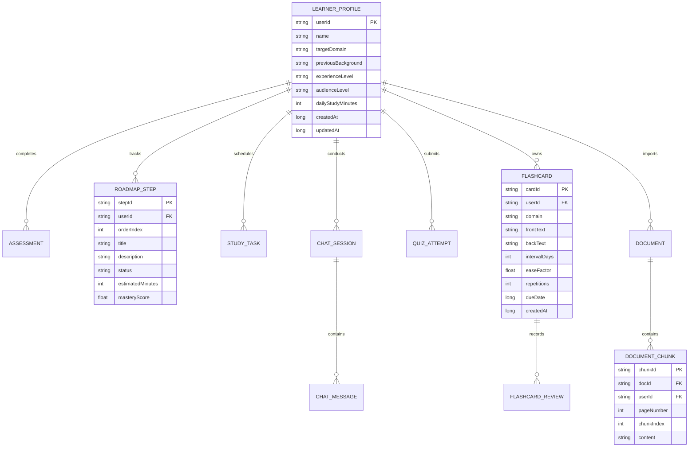

# 8. Database Design Specification

This document defines the persistent data architecture, Entity-Relationship (ER) model, Room SQLite schema, indexing strategy, and full-text search (FTS4) integration for Lama Learning App (LearnMate AI).

---

## 1. Entity-Relationship (ER) Diagram



---

## 2. Table Schemas & Room Entities

### 2.1 `learner_profiles`
Stores the active learner's goals, prior experience, and pedagogical settings.
```sql
CREATE TABLE IF NOT EXISTS learner_profiles (
    userId TEXT PRIMARY KEY NOT NULL,
    name TEXT NOT NULL,
    targetDomain TEXT NOT NULL,
    previousBackground TEXT NOT NULL,
    experienceLevel TEXT NOT NULL,
    audienceLevel TEXT NOT NULL,
    dailyStudyMinutes INTEGER NOT NULL DEFAULT 60,
    onboardingCompleted INTEGER NOT NULL DEFAULT 0,
    createdAt INTEGER NOT NULL,
    updatedAt INTEGER NOT NULL
);
```

### 2.2 `roadmap_steps`
Represents the sequential learning journey derived from the learner's skill gap.
```sql
CREATE TABLE IF NOT EXISTS roadmap_steps (
    stepId TEXT PRIMARY KEY NOT NULL,
    userId TEXT NOT NULL,
    orderIndex INTEGER NOT NULL,
    title TEXT NOT NULL,
    description TEXT NOT NULL,
    status TEXT NOT NULL, -- LOCKED, AVAILABLE, IN_PROGRESS, MASTERED
    prerequisiteStepId TEXT,
    estimatedMinutes INTEGER NOT NULL,
    masteryScore REAL NOT NULL DEFAULT 0.0,
    FOREIGN KEY(userId) REFERENCES learner_profiles(userId) ON DELETE CASCADE
);
CREATE INDEX IF NOT EXISTS idx_roadmap_user ON roadmap_steps(userId, orderIndex);
```

### 2.3 `flashcards` & `flashcard_reviews` (Spaced Repetition SM-2)
Implements clean-room SuperMemo SM-2 spaced repetition persistence.
```sql
CREATE TABLE IF NOT EXISTS flashcards (
    cardId TEXT PRIMARY KEY NOT NULL,
    userId TEXT NOT NULL,
    domain TEXT NOT NULL,
    topic TEXT NOT NULL,
    frontText TEXT NOT NULL,
    backText TEXT NOT NULL,
    intervalDays INTEGER NOT NULL DEFAULT 1,
    easeFactor REAL NOT NULL DEFAULT 2.5,
    repetitions INTEGER NOT NULL DEFAULT 0,
    dueDate INTEGER NOT NULL,
    createdAt INTEGER NOT NULL,
    FOREIGN KEY(userId) REFERENCES learner_profiles(userId) ON DELETE CASCADE
);
CREATE INDEX IF NOT EXISTS idx_flashcards_due ON flashcards(userId, dueDate);

CREATE TABLE IF NOT EXISTS flashcard_reviews (
    reviewId TEXT PRIMARY KEY NOT NULL,
    cardId TEXT NOT NULL,
    userId TEXT NOT NULL,
    reviewRating INTEGER NOT NULL, -- 1: Again, 2: Hard, 3: Good, 4: Easy
    reviewedAt INTEGER NOT NULL,
    FOREIGN KEY(cardId) REFERENCES flashcards(cardId) ON DELETE CASCADE
);
```

### 2.4 Document RAG Tables: `documents` & `document_chunks_fts`
Enables offline full-text search (FTS4) for grounded on-device RAG querying.
```sql
CREATE TABLE IF NOT EXISTS documents (
    docId TEXT PRIMARY KEY NOT NULL,
    userId TEXT NOT NULL,
    title TEXT NOT NULL,
    filePath TEXT NOT NULL,
    fileSize INTEGER NOT NULL,
    pageCount INTEGER NOT NULL,
    importedAt INTEGER NOT NULL,
    FOREIGN KEY(userId) REFERENCES learner_profiles(userId) ON DELETE CASCADE
);

-- Virtual FTS4 table for lightning-fast keyword and snippet search
CREATE VIRTUAL TABLE IF NOT EXISTS document_chunks_fts USING fts4(
    docId,
    userId,
    pageNumber,
    chunkIndex,
    content,
    tokenize=unicode61
);
```

### 2.5 `chat_sessions` & `chat_messages`
Stores conversation turns, estimated prompt tokens, and on-device execution metrics.
```sql
CREATE TABLE IF NOT EXISTS chat_sessions (
    sessionId TEXT PRIMARY KEY NOT NULL,
    userId TEXT NOT NULL,
    domain TEXT NOT NULL,
    title TEXT NOT NULL,
    createdAt INTEGER NOT NULL,
    updatedAt INTEGER NOT NULL,
    FOREIGN KEY(userId) REFERENCES learner_profiles(userId) ON DELETE CASCADE
);

CREATE TABLE IF NOT EXISTS chat_messages (
    messageId TEXT PRIMARY KEY NOT NULL,
    sessionId TEXT NOT NULL,
    userId TEXT NOT NULL,
    senderRole TEXT NOT NULL, -- USER, TUTOR, SYSTEM
    text TEXT NOT NULL,
    promptTokensEstimate INTEGER NOT NULL DEFAULT 0,
    generatedTokens INTEGER NOT NULL DEFAULT 0,
    ttftMs INTEGER,
    decodeTokensPerSec REAL,
    timestamp INTEGER NOT NULL,
    FOREIGN KEY(sessionId) REFERENCES chat_sessions(sessionId) ON DELETE CASCADE
);
CREATE INDEX IF NOT EXISTS idx_messages_session ON chat_messages(sessionId, timestamp ASC);
```

---

## 3. Data Integrity & Migration Strategy

1. **Strict User Partitioning**: Every query in `LearnMateDao` filters explicitly by `userId`. When switching profiles, data is cleanly segregated without clearing SQLite files.
2. **Room Database Migration**: Configured with `fallbackToDestructiveMigration(false)` and explicit `Migration(1, 2)` objects to preserve learner study records across app updates.
3. **FTS4 Synchronization**: A Room database callback manages synchronization between the primary document chunks table and the virtual FTS4 index, ensuring search queries return immediate, snippet-highlighted results.

---

## 2026-11-01 Confirmed Decisions and Database Requirements

- The application must support English, Tamil, Hindi, and Kannada from the first competition MVP. Persist the selected UI language and AI response language separately if the user chooses different languages.
- Language switching must not reset learner identity, assessment attempts, skill mastery, roadmap completion, study-plan history, flashcards, or chat history.
- Store language tags using stable BCP-47-compatible values (for example `en`, `ta`, `hi`, `kn`) and define fallback behaviour for missing translations.
- Preserve Unicode end-to-end in Room entities, SQLite queries, PDF text extraction, prompts, chat messages, and exported/imported learning content.
- Keep Room tables as the source of truth. If an FTS virtual table is used, specify and test insert, update, and delete synchronisation with its source chunk table, including database migrations.
- Add/verify a normalised document and document-chunk schema with document ownership, page number, chunk order, extracted text, language, and source metadata. Enforce user/profile ownership on every query.
- FTS decision is not final: SQLite FTS4 does not provide the same built-in `bm25()` function as FTS5. Use a tested custom FTS4 ranking implementation or evaluate FTS5 on the target Android SQLite build.
- Add migration tests for every schema version and tests for multilingual Unicode search, including Tamil, Hindi, and Kannada terms.
