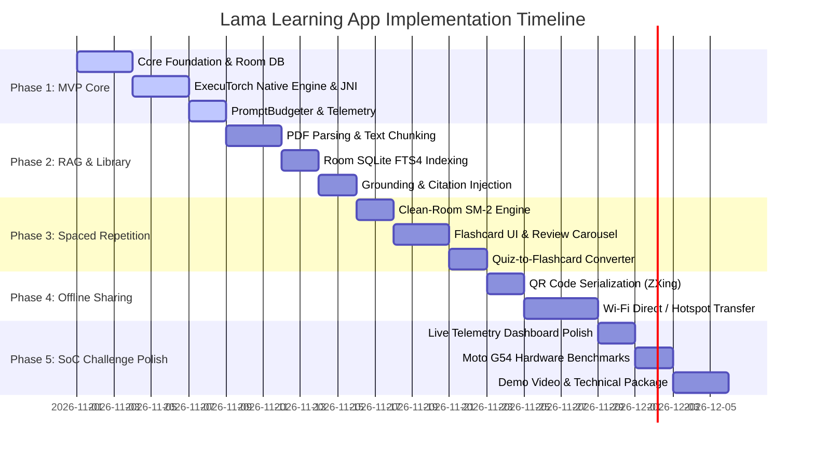

# 13. Implementation Roadmap Specification

This document defines the structured 5-phase engineering roadmap for building, validating, and polishing Lama Learning App (LearnMate AI) to secure victory in the Bharat AI-SoC Challenge 2026–27.

---

## 1. Roadmap Overview & Timeline

---

## 2. Phase-by-Phase Technical Breakdown

### Phase 1: MVP Core Foundation & On-Device Llama Execution
- **Objective**: Establish the rock-solid base architecture, Room database, domain-general onboarding, and verified on-device Llama 3.2 1B inference.
- **Key Deliverables**:
  1. Initialize `:core:model`, `:core:database`, `:core:ai-engine`, and `:app` modules.
  2. Implement `LearnMateDatabase.kt` and `RoomEntitiesAndDao.kt` with multi-user isolation.
  3. Implement `ModelAssetManager.kt` with 64 KiB chunked streaming and `.partial` atomic swap.
  4. Implement `PromptBudgeter.kt` with BPE estimation, dynamic output reservation, and 512/2048 context protection.
  5. Implement `ExecuTorchLlamaEngine.kt` with single-thread executor, Kotlin Coroutines `Mutex`, and native `LlmModule` token streaming.
  6. Implement Jetpack Compose UI with Stitch/Figma light theme and AI-dark theme.
- **Acceptance Criteria**:
  - `.\gradlew.bat :app:testDebugUnitTest` passes 100%.
  - Real token streaming works on both Android Studio Emulator (`x86_64`) and Moto G54 (`arm64-v8a`).

### Phase 2: On-Device Document RAG (Adopted from TrueNotes / LocalMind)
- **Objective**: Allow learners to import study PDFs and notes, performing instant offline semantic/keyword retrieval to ground AI answers with verifiable citations.
- **Key Deliverables**:
  1. Implement `DocumentParser.kt` using Android's native `PdfRenderer` and text extractors.
  2. Implement SQLite FTS4 virtual table `document_chunks_fts` with BM25 snippet ranking.
  3. Update `PromptBudgeter.kt` to inject retrieved document chunks into the system prompt:
     `[Grounded Study Excerpt from {title}, Page {page}]: {snippet}`.
  4. Display citation badges in the chat bubble (e.g., `[Ref: VLSI_Notes.pdf, p. 14]`).
- **Acceptance Criteria**:
  - Asking questions about an imported PDF produces answers containing exact textual quotes and page citations without internet access.

### Phase 3: Spaced Repetition Flashcard Engine (Adopted from TrueNotes / Anki)
- **Objective**: Maximize long-term conceptual retention by scheduling automated daily reviews for weak concepts.
- **Key Deliverables**:
  1. Author `SpacedRepetitionEngine.kt` implementing the clean-room SuperMemo SM-2 algorithm.
  2. Create `FlashcardEntity` and `FlashcardReviewEntity` in Room SQLite with indexing on `dueDate`.
  3. Build `FlashcardScreen.kt` with animated 3D card-flip gesture and 4-tier grading buttons (`Again`, `Hard`, `Good`, `Easy`).
  4. Implement an automated "Convert Missed Quiz Questions into Flashcards" feature.
- **Acceptance Criteria**:
  - Grading a card as "Again (1)" resets its interval to 1 day; grading "Easy (4)" exponentially expands the interval according to the updated Ease Factor.

### Phase 4: Zero-Data Offline Deck Sharing (Adopted from Open Gurukul & Hiraia)
- **Objective**: Allow students and teachers in offline classrooms to distribute study packs and flashcard decks without mobile data.
- **Key Deliverables**:
  1. Implement `QrDeckCodec.kt` using `java.util.zip.Deflater` and `com.google.zxing:core` to serialize up to 50 flashcards into high-density scannable QR codes.
  2. Implement `WifiDirectShareManager.kt` using Android `WifiP2pManager` to transfer heavy study packs and `.pte` models over high-speed local Wi-Fi Direct.
- **Acceptance Criteria**:
  - Phone A displays a QR code; Phone B scans it with its camera and imports the flashcard deck in under 1 second with 0 network connectivity.

### Phase 5: Bharat AI-SoC Challenge Optimization & Presentation Package
- **Objective**: Package hardware benchmarks, telemetry logs, video demonstration scripts, and presentation materials for competition evaluation.
- **Key Deliverables**:
  1. Finalize `DiagnosticsScreen.kt` showing live PSS memory, TTFT, decode throughput, CPU core frequencies, and thermal state.
  2. Run automated physical Moto G54 benchmark script `phase5_6_provision_and_verify_device.ps1`, archiving raw logs.
  3. Produce `DEMO_VIDEO_OUTLINE.md` and complete technical presentation slide deck.
- **Acceptance Criteria**:
  - Incontrovertible proof of on-device Arm64 SoC performance with zero cloud calls, passing all technical audit checks.

---

## 2026-11-01 Confirmed Implementation Roadmap

### Milestone 1 — Competition MVP (target window: 1–23 November 2026; re-check official deadline)
1. Freeze the PS4 product definition and app name.
2. Create/verify the Android project and dependency baseline.
3. Build the smallest ExecuTorch + XNNPACK + Llama 3.2 1B proof-of-concept on the physical Moto G54 (`arm64-v8a`); keep the `x86_64` emulator as a secondary target.
4. Implement learner profile, onboarding, and language selection (English, Tamil, Hindi, Kannada).
5. Implement deterministic diagnostic assessment and skill-gap engine.
6. Implement personalised roadmap and daily study plan.
7. Integrate the on-device tutor only after the runtime proof-of-concept passes.
8. Add multilingual UI resources, prompt language control, and per-language quality tests.
9. Run end-to-end tests and capture reproducible device benchmarks.
10. Prepare a reproducible demo and submission evidence.

### Milestone 2 — Expanded PoC (through the official PoC deadline; verify date)
- Improve learner adaptation and domain coverage.
- Add offline PDF text extraction, retrieval and citations.
- Add flashcards and spaced repetition.
- Evaluate QR/Wi-Fi Direct sharing only after permissions and offline privacy design are settled.
- Complete thermal, memory, accessibility, multilingual quality, and reliability testing.

### Release gates
- Do not proceed from runtime spike to full integration until actual ARM64 inference, cancellation, repeated generation, and memory behaviour are validated on Moto G54.
- Do not mark a feature complete until it passes its acceptance tests on the declared target.
- Confirm current official challenge dates before planning against them.
