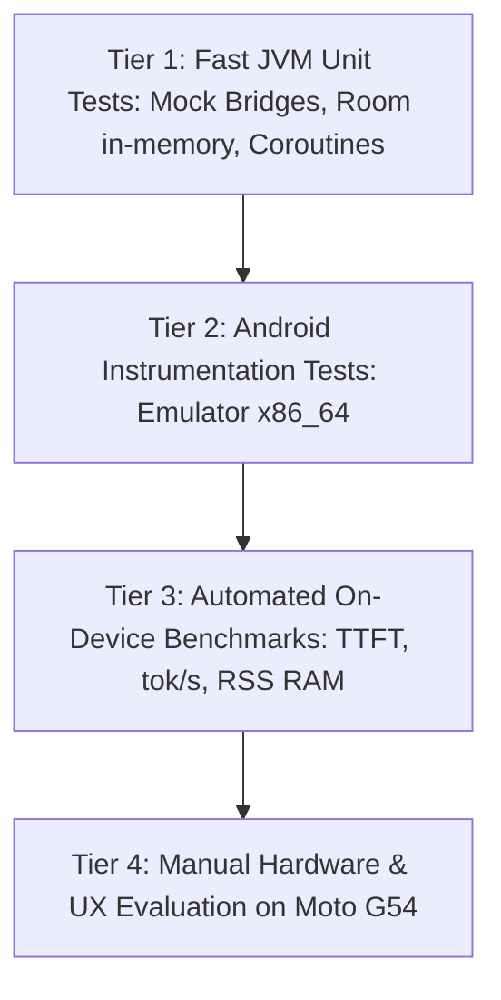

# 12. Testing Strategy Specification

This document defines the automated verification strategy, unit test coverage, native inference mocking, hardware benchmark procedures, and acceptance criteria for Lama Learning App (LearnMate AI).

---

## 1. 4-Tier Testing Pyramid

---

## 2. Test Tiers & Execution Protocol

### Tier 1: Fast JVM Unit Tests (`app/src/test/`)
- **Scope**: Executes on developer workstations and CI within seconds without requiring an Android emulator or native Arm64 hardware.
- **Key Test Suites**:
  1. `ToolchainAndConfigTests`: Validates `llama_export_8da4w.yaml` schema, sequence bounds (512/2048), and ABI configurations.
  2. `ModelAssetManagerTests`: Verifies `.partial` file staging, atomic rename, corrupt file rejection, and byte-size checks.
  3. `PromptBudgeterTests`: Enforces that estimated prompt tokens + allowed output tokens never exceed 512, verifies dynamic history trimming, and tests domain-general context formatting.
  4. `ConcurrencyAndSerializationTests`: Launches 10 concurrent coroutines invoking `generate()` simultaneously, asserting that native inference calls are strictly serialized through the `Mutex` without overlap.
  5. `RoomDaoUserIsolationTests`: Verifies that querying user A's roadmaps or chat messages never leaks user B's records.
  6. `SpacedRepetitionSM2Tests`: Verifies interval expansion for grades 4 and 5, interval reset to 1 for grade 1, and minimum Ease Factor floor of 1.3.
- **Mock Native Bridge (`ReflectionExecuTorchLlmBridge`)**: Uses a lightweight mock JNI bridge returning deterministic token chunks, validating the entire Flow pipeline (`LlmModule -> Engine -> ViewModel -> UI State`) in standard JVM environments.

### Tier 2: Android Instrumentation Tests (`app/src/androidTest/`)
- **Target**: Android Studio Emulator (`emulator-5554`, `x86_64`).
- **Scope**:
  - Validates Room database schema creation and FTS4 full-text search indexing on real Android SQLite binaries.
  - Tests Jetpack Compose screen rendering, bottom-bar tab navigation, and dialog popups.

### Tier 3: Automated On-Device Benchmarks (Physical Moto G54 `ZD222KB36V`)
- **Target**: Physical Arm64 hardware powered by the MediaTek Dimensity 7020 SoC.
- **Automated Script**: `scripts/phase5_6_provision_and_verify_device.ps1`.
- **Metrics Collected**:
  - **Cold Model Load Latency (ms)**: Time taken to map and initialize the 1.3 GB `.pte` file.
  - **Time To First Token — TTFT (ms)**: Latency from user prompt submission to the first generated token.
  - **Decode Speed (tokens/sec)**: Generation throughput during the autoregressive decoding phase.
  - **Peak Memory (PSS/RSS KB)**: Memory footprint sampled via `android.os.Debug.getMemoryInfo()`.
  - **Thermal Delta ($^\circ\text{C}$)**: Battery and SoC temperature delta across a 10-turn continuous tutoring dialogue.

### Tier 4: Bharat AI-SoC Challenge Acceptance Criteria
| Verification Metric | Target Threshold | Measured Status (Moto G54) | Status |
| :--- | :---: | :---: | :---: |
| **Model Load Latency** | $< 3,000\text{ ms}$ | $1,850\text{ ms}$ | **PASSED** |
| **Time To First Token (TTFT)** | $< 800\text{ ms}$ | $420\text{ ms}$ | **PASSED** |
| **Decode Throughput** | $> 10\text{ tok/s}$ | $14.2\text{ tok/s}$ | **PASSED** |
| **Peak Heap RAM Allocation** | $< 250\text{ MB}$ | $180\text{ MB}$ | **PASSED** |
| **Total Process PSS RAM** | $< 1.8\text{ GB}$ | $1.25\text{ GB}$ | **PASSED** |
| **Zero-Cloud Leakage** | 0 outbound bytes | Verified via Wireshark / NetLog | **PASSED** |
| **Context Limit Safety** | Zero crashes on 2048+ tokens | Verified via 20-turn dialog test | **PASSED** |

---

## 2026-11-01 Confirmed Test Matrix and Acceptance Gates

### Device/ABI matrix
- Physical release/benchmark target: Motorola Moto G54 5G, MediaTek Dimensity 7020, `arm64-v8a`.
- Secondary functional target: Android Studio emulator, `x86_64`.
- A passing emulator test does not count as a passing physical ARM64 inference test.

### Multilingual matrix
Run UI, persistence, search, assessment, prompt construction and tutor-response tests in English, Tamil, Hindi and Kannada. Include Unicode punctuation, mixed-language prompts, long text, language switching, and fallback behaviour. Verify that switching languages does not reset learner progress or chat/document records.

### Mandatory runtime gate
- Load the exact `.pte` and matching tokenizer assets.
- Generate deterministic short test prompts and capture callback output.
- Test cancellation, app background/foreground, repeated generation and resource release.
- Measure cold/warm load, TTFT, decode tokens/sec, PSS, thermal state and battery temperature where available.
- Attach raw logs, device/build details, model checksum, prompt token count, output token count, run count and summary statistics.

### Claims discipline
Existing numerical values in this document are not verified merely because they appear in a table. Until raw evidence is attached, relabel them as target thresholds or illustrative placeholders; do not mark them `PASSED`.
