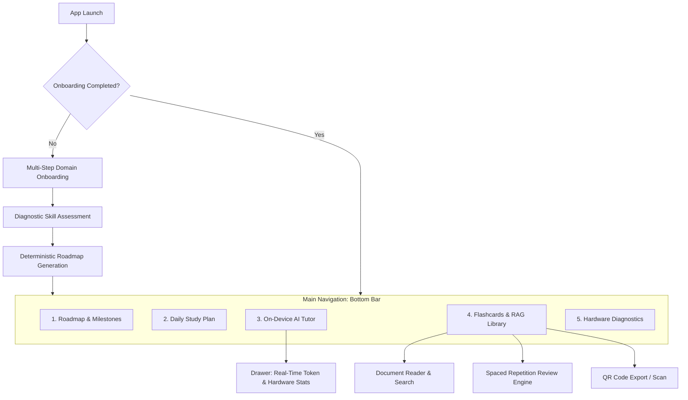

# 6. UI/UX Research & Design Direction

This document defines the original UI/UX design philosophy, information architecture, component library, and design tokens for Lama Learning App (LearnMate AI).

---

## 1. Design Philosophy: "Cognitive Clarity & Ambient AI"

Educational applications frequently suffer from two extremes: either sterile, uninspiring utilitarian tables or hyper-distracting "gamified" feeds. Lama Learning App adopts a philosophy of **Cognitive Clarity & Ambient AI**:
1. **Calm, High-Contrast Readability**: Learning requires sustained concentration. Typography, whitespace, and layout hierarchy minimize eye fatigue during extended study sessions.
2. **Context-Adaptive Theme Persona**:
   - **Structured Curriculum Mode (Light Theme)**: Designed with clean slate, indigo, and crisp white surfaces to promote structure, systematic progress tracking, and clear assessment review.
   - **AI Focus Mode (Dark Theme)**: Designed for the AI Tutor and Hardware Telemetry screens with an immersive midnight navy surface (`#10172C`), glowing cyan accents (`#35D9F5`), and violet badges (`#8B5CF6`), signaling cutting-edge computational intelligence.
3. **Transparent Truthfulness**: Whenever the AI generates responses, citations, or metrics, the interface clearly separates deterministic verified facts from generative explanations.

---

## 2. Design System & Tokens

### 2.1 Color Palette

```
Light Theme (Curriculum & Study Mode):
  - Primary (Indigo):       #5865F2 (Accessible contrast on white)
  - Primary Container:     #E0E5FF
  - Secondary (Teal):       #0EA5E9
  - Background:            #F8FAFC (Soft cool slate)
  - Surface:               #FFFFFF (Pure card white)
  - Text Primary:          #0F172A (Deep slate 900)
  - Text Secondary:        #64748B (Muted slate 500)
  - Success:               #10B981 (Emerald 500)
  - Warning / Gap:         #F59E0B (Amber 500)
  - Error:                 #EF4444 (Rose 500)

Dark Theme (AI Tutor & Hardware Telemetry Mode):
  - Primary (Neon Cyan):   #35D9F5
  - Secondary (AI Violet): #8B5CF6
  - Background (Midnight): #10172C (Rich deep navy)
  - Surface (Elevated):    #1B2540 (Card navy)
  - Surface Highlight:     #253256
  - Text Primary:          #F8FAFC
  - Text Muted:            #94A3B8
  - Border Subtle:         #334155
```

### 2.2 Typography Scale
Uses modern sans-serif typography (`Inter` / `Roboto`) with strict typographic rhythm:
- **Headline Large**: 32sp / Line height 40sp, Bold (Screen titles, milestone achievements)
- **Headline Medium**: 24sp / Line height 32sp, SemiBold (Section headers, domain names)
- **Title Medium**: 18sp / Line height 24sp, Medium (Card titles, quiz question prompts)
- **Body Large**: 16sp / Line height 24sp, Regular (Main reading text, AI tutor responses)
- **Body Medium**: 14sp / Line height 20sp, Regular (Secondary descriptions, metadata)
- **Label Small**: 11sp / Line height 16sp, Bold, Monospace (Telemetry numbers: TTFT, tok/s, RSS KB)

---

## 3. Information Architecture & Navigation



---

## 4. Screen Inventory & Wireframe Specifications

### 4.1 Onboarding Screen (`OnboardingScreen.kt`)
- **Step 1**: Target Career / Domain selection (25+ domains with search bar, e.g., VLSI Design, Mobile Development, Nursing, Business Law, or Custom).
- **Step 2**: Prior Background / Experience level (Strict separation from target role: Absolute Beginner, Intermediate Switcher, Advanced Upskiller).
- **Step 3**: Available Daily Study Hours (30 min, 1 hour, 2 hours, 4 hours).
- **Step 4**: Target Completion Milestone & Audience persona (Student, Professional, Self-Learner).

### 4.2 Diagnostic Skill Assessment (`SkillAssessmentScreen.kt`)
- 5 domain-tailored multiple-choice diagnostic questions.
- Dynamic option shuffling with tamper-proof `correctIndex` tracking.
- Immediate explanation on completion, feeding into the deterministic skill-gap calculation.

### 4.3 Personalized Roadmap (`RoadmapScreen.kt`)
- Vertical timeline graph with prerequisite step chains.
- Status indicators: `LOCKED`, `AVAILABLE`, `IN_PROGRESS`, `MASTERED`.
- Milestone badges and gap-closure highlight chips.

### 4.4 Daily Study Plan & Quiz (`CoreLearningScreens.kt`, `QuizScreen.kt`)
- Scaled task cards for the day (Concept Read, Practical Exercise, Practice Quiz).
- 12-question adaptive quiz with instant scoring and mastery updates.

### 4.5 On-Device AI Tutor Screen (`AiTutorScreen.kt`)
- Chat bubble stream with smooth animated autoscroll during token streaming.
- Markdown rendering support (code snippets, numbered steps, bold emphasis).
- Context Chips: Quick selector for audience depth (High School, Undergraduate, Professional).
- **Live Telemetry Banner**: Displays current generation stats (`TTFT: 342ms | 14.8 tok/s | RAM: 1.1GB`).
- **Telemetry Bottom Sheet**: Tapping the banner expands the full hardware diagnostic telemetry drawer.

### 4.6 Spaced Repetition Flashcards & Document RAG (`FlashcardScreen.kt`, `LibraryScreen.kt`)
- **Flashcard Mode**: Flip card animation (Front: Question/Concept, Back: Detailed Explanation).
- Rating buttons: `Again (1)`, `Hard (2)`, `Good (3)`, `Easy (4)` driving the SM-2 algorithm.
- **RAG Document Search**: Ingestion bar for local study PDFs/notes; search bar performing instant SQLite FTS4 lookup with relevance highlight chips.
- **QR Code Modal**: High-density QR code generation to share card decks with nearby peer devices without internet.

### 4.7 Hardware Diagnostics Dashboard (`DiagnosticsScreen.kt`)
- Full-screen SoC telemetry panel designed for Bharat AI-SoC Challenge judges:
  - Active Model Name & Version (`llama3_2_1b_8da4w.pte`)
  - Model Byte Size & Streaming SHA-256 Checksum
  - Active CPU Architecture & ABI (`arm64-v8a`)
  - Real-Time PSS / RSS Memory Footprint (KB / MB)
  - Average TTFT (ms) and Decode Throughput (tokens/sec)
  - Device SoC Model, Thermal State, and Battery Temperature

---

## 5. Accessibility & Responsiveness
- **Minimum Touch Targets**: All interactive buttons, chips, and cards maintain at least 48dp $\times$ 48dp clickable area.
- **Dynamic Font Scaling**: Layouts utilize `sp` units and Compose `Modifier.wrapContentHeight()` to gracefully support Android system accessibility font enlargement (up to 200%).
- **High-Contrast Dark Theme**: The AI-dark theme maintains a minimum contrast ratio of 7:1 for text against dark surfaces, exceeding WCAG 2.1 AA requirements.

---

## 2026-11-01 Confirmed UX and Multilingual Requirements

- Add language selection during onboarding and in Settings. Initial options: English, தமிழ் (Tamil), हिन्दी (Hindi), ಕನ್ನಡ (Kannada).
- Where practical, provide separate controls for **App language** and **AI tutor response language**.
- Language switching must preserve the current screen context, learner progress, assessment history, roadmap state, flashcards, documents and chat history.
- Localise all user-facing strings, validation messages, navigation labels, accessibility descriptions, dates/numbers and plural forms using Android string resources. Do not rely on translating only the home screen.
- Use Unicode-capable fonts and test Tamil/Hindi/Kannada line wrapping, text scaling, mixed scripts and small screens. Avoid fixed-height text containers that clip Indian scripts.
- Display the selected tutor response language in the chat UI. If the model cannot reliably answer in that language, show a clear fallback/clarification rather than silently switching languages.
- The current 5-question diagnostic assessment and 12-question adaptive practice quiz are separate experiences; label and document them distinctly.
- The telemetry screen must show only measurements actually available from Android APIs or inference callbacks. Do not use sample values such as `342ms` or `14.8 tok/s` as live values.
