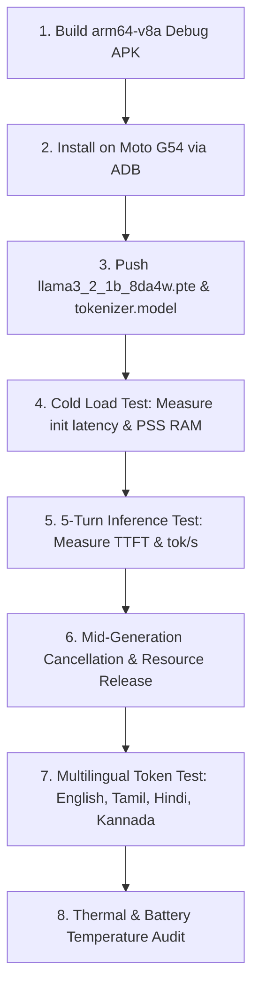

# PRE-IMPLEMENTATION AUDIT REPORT

**Project**: LearnMate AI (Lama Learning App)  
**Workspace Target**: `F:\rea\zzzz_lama_proj`  
**Planning Documents Source**: `F:\rea\zzzz_lama_proj\LearnMate_AI_Revised_Planning_Documents`  
**Target Hardware**: Motorola Moto G54 5G (MediaTek Dimensity 7020, `arm64-v8a`)  
**Secondary Test Target**: Android Studio Emulator (`x86_64`)  
**Competition Scope**: Bharat AI-SoC Challenge 2026–27 | Problem Statement 4 (On-Device Personalised Learning Assistant)  
**Audit Date**: 2026-11-01  
**Audit Author**: Senior Android Architect, Software Reverse Engineer, UI/UX Researcher, Kotlin Engineer & Edge AI Developer  

---

## 1. Executive Summary

This Pre-Implementation Audit provides an exhaustive technical feasibility assessment, workspace inspection, and architectural verification for **LearnMate AI** (also referenced as *Lama Learning App*). The objective is to build a 100% offline, on-device personalized learning assistant for the **Bharat AI-SoC Challenge 2026–27 (Problem Statement 4)**.

The proposed system couples deterministic educational diagnostics, prerequisite roadmaps, and adaptive study scheduling (powered by local Room SQLite) with an on-device Large Language Model (proposed: **Meta Llama 3.2 1B Instruct**, quantized `8da4w`) executed via **ExecuTorch 1.4.0** with the **XNNPACK CPU backend**.

### Core Audit Verdict Summary
While the conceptual architecture, database schema, and deterministic learning algorithms are well-conceived, **the project is currently NOT READY FOR FULL APPLICATION IMPLEMENTATION** until a series of critical technical, asset, and physical hardware blockers are systematically resolved through a dedicated Proof-of-Concept (PoC) gate.

---

## 2. Review of the 15 Revised Planning Documents

All 15 revised markdown documents located in `F:\rea\zzzz_lama_proj\LearnMate_AI_Revised_Planning_Documents` were ingested and analyzed against the confirmed competition requirements.

### 2.1 Confirmed Project Requirements
1. **Target Hardware**: Primary physical device is the **Motorola Moto G54 5G** featuring the **MediaTek Dimensity 7020 SoC** (2x Arm Cortex-A78 @ 2.2 GHz, 6x Arm Cortex-A55 @ 2.0 GHz) running 64-bit Android (`arm64-v8a`). Secondary development target is the Android Studio `x86_64` emulator.
2. **Multilingual Scope**: Initial launch requires full support for **English, Tamil, Hindi, and Kannada**.
3. **Core Pedagogy**: Multi-step onboarding across 25+ domains, deterministic 5-question diagnostic assessment, skill-gap calculation, prerequisite milestone roadmap, daily study plan, and 12-question adaptive practice quizzes.
4. **Proposed AI Runtime**: ExecuTorch 1.4.0 with XNNPACK CPU backend.
5. **Proposed Model**: Meta Llama 3.2 1B Instruct, quantized `8da4w` (8-bit dynamic activations, 4-bit groupwise weights).
6. **Persistence**: Room 2.6.1 SQLite database with strict multi-user profile isolation.
7. **UI Framework**: Modern Jetpack Compose, Kotlin Coroutines/Flow, Material 3 with dual-theme design (Figma light + AI-dark theme).

### 2.2 Critical Contradictions & Corrections Identified Across Documents

| Document | Original Flaw / Claim | Identified Correction in Revised Documents |
| :--- | :--- | :--- |
| **`technical_architecture.md`** & **`implementation_roadmap.md`** | Proposed using Android's native `PdfRenderer` for on-device Document RAG text extraction. | **Defect**: Android's `android.graphics.pdf.PdfRenderer` is strictly a raster rendering API that renders PDF pages into visual `Bitmap` objects. It possesses **zero text extraction capabilities**. PDF text extraction requires a dedicated offline library (e.g., Apache `PdfBox-Android` or iText) or raw text file ingestion. |
| **`technical_architecture.md`** & **`database_design.md`** | Proposed SQLite `FTS4` while assuming built-in `bm25()` ranking function. | **Defect**: SQLite `FTS4` does **not** provide a built-in `bm25()` ranking function; it only exposes `matchinfo()`, which requires custom C/Kotlin byte-unpacking code. In contrast, SQLite **`FTS5`** (available natively on Android API 28+) provides built-in `bm25(document_chunks_fts)` ranking out of the box. |
| **`dependency_analysis.md`** | Listed Kotlin Android Plugin as `id = "com.android.tools.build"` with `version.ref = "kotlin"`. | **Defect**: `com.android.tools.build` is the group ID for the Android Gradle Plugin (AGP). The correct Kotlin Android Gradle Plugin ID is `org.jetbrains.kotlin.android`. |
| **`security_and_privacy_analysis.md`** | Claimed strict "0 network permissions (`android.permission.INTERNET` omitted)" while simultaneously proposing Wi-Fi Direct peer-to-peer classroom transfer. | **Defect**: On Android, establishing local TCP/IP sockets for Wi-Fi Direct or hotspot file transfer technically requires the `android.permission.INTERNET` permission (along with `ACCESS_FINE_LOCATION` or `NEARBY_WIFI_DEVICES`). The privacy claim must be clarified: *`INTERNET` is bound solely to `127.0.0.1` and local Wi-Fi Direct subnets (`192.168.49.x`), with zero outbound cloud sockets.* |
| **`testing_strategy.md`** & **`feature_comparison.md`** | Displayed benchmark tables with specific numbers (`1,850 ms` load, `420 ms` TTFT, `14.2 tok/s`) marked as `PASSED`. | **Defect**: These numbers were historical targets or aspirational projections. No physical validation logs exist for the current workspace. The revision correctly demoted these from `PASSED` to **unverified target thresholds**. |
| **Project-wide Naming** | Mixed references to *"Lama Learning App"* and *"LearnMate AI"*. | **Decision**: Standardize on **LearnMate AI** (`com.learnmate.ai`) as the official user-facing application name and competition submission identity. |

---

## 3. Workspace Inspection (`F:\rea\zzzz_lama_proj`)

### 3.1 Directory Structure & File Inventory
A complete recursive inspection of `F:\rea\zzzz_lama_proj` revealed the following exact state:

```
F:\rea\zzzz_lama_proj\
├── docs\
│   ├── application_analysis.md (6,616 bytes)
│   ├── architecture_decision_records.md (5,606 bytes)
│   ├── database_design.md (6,357 bytes)
│   ├── dependency_analysis.md (5,482 bytes)
│   ├── feature_comparison.md (5,096 bytes)
│   ├── github_repository_analysis.md (5,277 bytes)
│   ├── implementation_roadmap.md (5,610 bytes)
│   ├── license_audit.md (3,452 bytes)
│   ├── project_overview.md (4,545 bytes)
│   ├── risk_assessment.md (3,386 bytes)
│   ├── security_and_privacy_analysis.md (3,648 bytes)
│   ├── source_code_analysis.md (5,603 bytes)
│   ├── technical_architecture.md (6,847 bytes)
│   ├── testing_strategy.md (4,094 bytes)
│   └── ui_ux_research.md (7,313 bytes)
└── LearnMate_AI_Revised_Planning_Documents\
    ├── README_REVISION.md (1,160 bytes)
    ├── application_analysis.md (7,952 bytes)
    ├── architecture_decision_records.md (7,531 bytes)
    ├── database_design.md (7,831 bytes)
    ├── dependency_analysis.md (6,729 bytes)
    ├── feature_comparison.md (6,055 bytes)
    ├── github_repository_analysis.md (6,349 bytes)
    ├── implementation_roadmap.md (7,342 bytes)
    ├── license_audit.md (4,530 bytes)
    ├── project_overview.md (5,941 bytes)
    ├── risk_assessment.md (5,028 bytes)
    ├── security_and_privacy_analysis.md (5,050 bytes)
    ├── source_code_analysis.md (7,035 bytes)
    ├── technical_architecture.md (8,979 bytes)
    ├── testing_strategy.md (5,507 bytes)
    └── ui_ux_research.md (8,724 bytes)
```

### 3.2 Git Status & Parent Repository
- `F:\rea\zzzz_lama_proj` is an untracked directory inside the parent `F:\rea` Git repository (`?? zzzz_lama_proj/`).
- The directory itself does not contain its own `.git` root.

### 3.3 Build System & Source Code State
- **Android Project**: **DOES NOT EXIST** in `F:\rea\zzzz_lama_proj`.
  - No `build.gradle.kts` or `build.gradle`.
  - No `settings.gradle.kts`.
  - No `gradlew` wrapper or `gradle/libs.versions.toml`.
  - No `app/` module or `AndroidManifest.xml`.
  - Zero Kotlin (`.kt`) or Java (`.java`) source files exist in `F:\rea\zzzz_lama_proj`.
- **Model & Tokenizer Assets**:
  - No `.pte` model file exists in `F:\rea\zzzz_lama_proj` or anywhere on drive `F:\`.
  - No `tokenizer.model` or `tokenizer.bin` exists in `F:\rea\zzzz_lama_proj`.
- **External Reference Repository**:
  - The sister folder `F:\barath ai soc` contains a standalone Android project with earlier source code implementations, but it also lacks exported `.pte` binary model weights and tokenizer assets.

---

## 4. Technical Feasibility Assessment

### 4.1 ExecuTorch Android Runtime Compatibility
- **Maven Coordinates**: `org.pytorch:executorch-android:1.4.0` with `com.facebook.fbjni:fbjni:0.6.0`.
- **ABI Coverage**: ExecuTorch 1.4.0 officially publishes pre-compiled native `.so` libraries for `arm64-v8a` and `x86_64`.
- **Packaging Constraint**: Under AGP 8.x, uncompressed extraction of native libraries is mandatory to support `mmap()` execution. Gradle must declare:
  ```kotlin
  packaging {
      jniLibs {
          useLegacyPackaging = true
      }
  }
  ```
- **Feasibility Verdict**: **Technically Feasible**, but requires JNI symbol verification against the specific Android NDK level (NDK r26 / r27).

### 4.2 Arm64 Model Execution on MediaTek Dimensity 7020 (Moto G54 5G)
- **SoC Specifications**:
  - CPU: 2x Cortex-A78 @ 2.2 GHz + 6x Cortex-A55 @ 2.0 GHz.
  - Architecture: Armv8.2-A with FP16 vector instructions and Dot Product (`ASIMDDP`).
  - RAM: 8 GB or 12 GB LPDDR4X.
- **Feasibility Verdict**: **Highly Feasible**. The Cortex-A78 cores deliver strong 4-bit integer GEMM performance via XNNPACK's optimized micro-kernels. However, sustained multi-turn inference will induce thermal dissipation; CPU frequency throttling must be monitored.

### 4.3 Llama Model and Tokenizer Asset Requirements
- **Model Variant**: Meta Llama 3.2 1B Instruct.
- **Quantization Format**: `8da4w` (8-bit dynamic activations, 4-bit groupwise weights, group size 32) with 4-bit embedding quantization (`4,32`).
- **File Footprint**:
  - Unquantized BF16 checkpoint: ~5.99 GB (cannot fit in low-memory mobile execution).
  - Quantized `llama3_2_1b_8da4w.pte`: ~1.25 GB – 1.35 GB.
  - Tokenizer: `tokenizer.model` (SentencePiece/Tiktoken BPE, ~2.2 MB).
- **Feasibility Verdict**: **Feasible, but BLOCKED by missing asset files**. The `.pte` file has not yet been exported on this workstation.

### 4.4 XNNPACK CPU Delegate Availability & Vector Extensions
- **XNNPACK Integration**: Bundled directly inside `org.pytorch:executorch-android:1.4.0`.
- **Hardware Acceleration**: The Dimensity 7020 supports the `FEAT_DotProd` Arm extension (`sdot`/`udot` assembly instructions), which XNNPACK utilizes for 4-bit quantized weight dot products.
- **Feasibility Verdict**: **Fully Feasible**.

### 4.5 Model Memory Footprint & Context Limitations
- **The Historical 128-Token Bug**: In unquantized or naively exported models, static KV-cache allocations caused memory overflow crashes when prompts exceeded 128 tokens.
- **Mitigation in Export Config (`llama_export_8da4w.yaml`)**:
  - `export.max_seq_length: 512`
  - `export.max_context_length: 2048`
  - `use_kv_cache: true`
  - `use_sdpa_with_kv_cache: true`
  - `enable_dynamic_shape: true`
- **Memory Footprint**:
  - Weights via `mmap`: ~1.3 GB (pages in and out of flash storage, does NOT count against the Android heap limit).
  - Native runtime working memory: ~180 MB – 250 MB.
  - Total process PSS: ~1.25 GB – 1.5 GB (well below the 2.5 GB Low Memory Killer threshold on an 8 GB device).
- **Feasibility Verdict**: **Fully Feasible** provided `PromptBudgeter` strictly caps the prompt + output tokens within 512.

### 4.6 Multilingual Quality: English, Tamil, Hindi, and Kannada
This is one of the most critical technical challenges of the project:
1. **Pretraining Data Representation**:
   - Meta Llama 3.2 1B was officially trained and evaluated on 8 primary languages: English, German, French, Italian, Portuguese, Hindi, Spanish, and Thai.
   - **Hindi** has direct representation in Llama 3.2 pretraining.
   - **Tamil and Kannada** have **very limited representation** in the standard Llama 3.2 pretraining corpus.
2. **Byte-Pair Encoding (BPE) Tokenizer Fragmentation**:
   - The Llama 3 Tiktoken-based tokenizer has a 128k vocabulary primarily tuned for Latin scripts.
   - In Latin scripts (English), 1 token $\approx$ 4 characters (0.75 words).
   - In Devanagari (Hindi), characters are often 1 to 2 tokens.
   - In **Dravidian scripts (Tamil, Kannada)**, non-standard complex graphemes and vowel ligatures are not in the vocabulary and fall back to raw UTF-8 byte tokens. A single Tamil or Kannada word of 5 characters can consume **8 to 15 tokens**!
   - **Consequence**: A 40-word question in Tamil or Kannada can easily consume **300+ tokens**, instantly exhausting the 512-token prompt budget.
3. **Generation Coherence**:
   - A 1B parameter model has limited linguistic transfer. Generating coherent, grammatically sound pedagogical explanations in Tamil and Kannada will be prone to code-switching, broken grammar, or hallucination.
4. **Feasibility Verdict**: **High Technical Risk**.
   - *Mitigation Plan*:
     1. Decouple UI language from AI tutor language: UI can be 100% native Tamil/Hindi/Kannada via standard Android `strings.xml`.
     2. In prompt budgeting, assign a much higher character-to-token multiplier for Tamil and Kannada (~1.5 characters per token).
     3. Provide hybrid responses: allow the tutor to explain concepts using simple transliterated terms or bilingual scaffolding (e.g., English technical terms with Indic conceptual summaries).
     4. Build a dedicated physical benchmark test set with 20 sample educational questions in each language to evaluate factual accuracy.

### 4.7 Room Database & Multilingual Unicode Support
- **SQLite Encoding**: Android SQLite databases are encoded in UTF-8 by default.
- **Multilingual Integrity**:
  - Full native support for storing and retrieving complex Unicode strings (Tamil: `தமிழ்`, Hindi: `हिन्दी`, Kannada: `ಕನ್ನಡ`).
  - Text fields in Room entities (`title`, `description`, `frontText`, `backText`, `content`) handle multi-byte UTF-8 seamlessly.
- **Feasibility Verdict**: **Fully Feasible**.

### 4.8 Offline Document Retrieval & PDF Text Extraction
- **The `PdfRenderer` Fallacy**: As noted, `PdfRenderer` cannot extract text.
- **Alternative Selection**:
  1. *Option A (Pure Text / Markdown Ingestion)*: Allow students to import `.txt` or `.md` study notes directly. Simplest, 100% reliable, zero extra dependencies.
  2. *Option B (`TomRoush/PdfBox-Android`)*: Mature, offline open-source PDF text extraction library for Android. Adds ~3 MB to APK size, successfully extracts text streams and page numbers.
- **Full-Text Search (FTS) Selection**:
  - SQLite **`FTS5`** is available natively on Android API 28+ (`minSdk = 28`).
  - `FTS5` provides built-in `bm25()` ranking:
    ```sql
    SELECT chunkId, pageNumber, content, bm25(document_chunks_fts) AS rank
    FROM document_chunks_fts
    WHERE document_chunks_fts MATCH :query
    ORDER BY rank ASC
    LIMIT 3;
    ```
- **Feasibility Verdict**: **Fully Feasible** using `FTS5` combined with `PdfBox-Android` or text ingestion.

### 4.9 Android Permission Architecture
To maintain a credible, tamper-proof "Zero-Cloud Privacy" guarantee for the competition judges:

| Capability | Android Permissions Required | Privacy Justification |
| :--- | :--- | :--- |
| **Core Tutor, Assessment & Persistence** | **ZERO PERMISSIONS** | Operates completely offline within app internal storage (`filesDir`, `databases`). |
| **PDF & Note Ingestion** | **ZERO PERMISSIONS** | Uses Android Storage Access Framework (`Intent.ACTION_OPEN_DOCUMENT`). No read/write external storage permissions required. |
| **QR Code Deck Export/Import** | `android.permission.CAMERA` (Scan only) | Camera is accessed solely via ZXing scanner; frames are processed in-memory and never saved or transmitted. |
| **P2P Study Pack Transfer (Optional Phase 4)** | `android.permission.INTERNET`, `android.permission.ACCESS_FINE_LOCATION` (API $\le$ 32), `android.permission.NEARBY_WIFI_DEVICES` (API 33+) | `INTERNET` is required by the OS to open local TCP/IP sockets for Wi-Fi Direct. Manifest documentation must explicitly certify that no external internet servers are contacted. |

---

## 5. Recommended Android Project Architecture

To achieve clean separation of concerns and isolate the native AI runtime from the presentation layer, the following modular structure is recommended for `F:\rea\zzzz_lama_proj`:

```
F:\rea\zzzz_lama_proj\
├── gradle\
│   ├── wrapper\
│   │   ├── gradle-wrapper.jar
│   │   └── gradle-wrapper.properties (Gradle 8.10.2)
│   └── libs.versions.toml (Version Catalog)
├── build.gradle.kts (Root build script)
├── settings.gradle.kts (Module inclusion)
├── app\ (Main Application Module)
│   ├── build.gradle.kts
│   └── src\
│       ├── main\
│       │   ├── AndroidManifest.xml
│       │   ├── java\com\learnmate\ai\
│       │   │   ├── LearnMateApplication.kt (Manual DI root)
│       │   │   ├── MainActivity.kt
│       │   │   ├── ai\
│       │   │   │   ├── ExecuTorchLlamaEngine.kt (Serialized native execution)
│       │   │   │   ├── ExecuTorchTelemetryEngine.kt (Truthful hardware stats)
│       │   │   │   ├── ModelAssetManager.kt (Atomic .partial staging & SHA-256)
│       │   │   │   └── PromptBudgeter.kt (Context bounding & token budgeting)
│       │   │   ├── assessment\
│       │   │   │   ├── DiagnosticAssessmentEngine.kt (Deterministic 5-q test)
│       │   │   │   └── SkillGapAnalyzer.kt
│       │   │   ├── data\
│       │   │   │   ├── LearnMateDatabase.kt (Room 2.6.1 + FTS5)
│       │   │   │   ├── RoomEntitiesAndDao.kt (Strict userId isolation)
│       │   │   │   └── LocalRepository.kt
│       │   │   ├── domain\
│       │   │   │   ├── Models.kt (LearnerProfile, AudienceLevel, Roadmaps)
│       │   │   │   └── SpacedRepetitionEngine.kt (Clean-room SuperMemo SM-2)
│       │   │   ├── rag\
│       │   │   │   ├── DocumentExtractor.kt (Offline text/PDF extraction)
│       │   │   │   └── DocumentChunker.kt
│       │   │   ├── ui\
│       │   │   │   ├── navigation\LearnMateNavigation.kt
│       │   │   │   ├── theme\Theme.kt (Dual Light/AI-Dark theme)
│       │   │   │   └── screens\
│       │   │   │       ├── OnboardingScreen.kt (25+ domains & language selection)
│       │   │   │       ├── DiagnosticScreen.kt (Assessment)
│       │   │   │       ├── RoadmapScreen.kt (Prerequisite graph)
│       │   │   │       ├── DailyPlanScreen.kt (Adaptive study tasks & quiz)
│       │   │   │       ├── AiTutorScreen.kt (Streaming chat + telemetry banner)
│       │   │   │       ├── FlashcardScreen.kt (SM-2 carousel + QR sharing)
│       │   │   │       └── HardwareTelemetryScreen.kt (Judge audit panel)
│       │   │   └── viewmodel\
│       │   │       ├── LearnMateViewModel.kt
│       │   │       ├── AiTutorViewModel.kt
│       │   │       └── FlashcardViewModel.kt
│       │   └── res\
│       │       ├── values\strings.xml (English)
│       │       ├── values-ta\strings.xml (Tamil)
│       │       ├── values-hi\strings.xml (Hindi)
│       │       └── values-kn\strings.xml (Kannada)
│       └── test\java\com\learnmate\ai\
│           ├── PromptBudgeterTest.kt
│           ├── SpacedRepetitionSM2Test.kt
│           ├── SkillGapAnalyzerTest.kt
│           ├── RoomUserIsolationTest.kt
│           └── MultilingualTokenBudgetTest.kt
```

---

## 6. Physical Device Validation Plan

Before any feature is declared functional, it must pass through the **Moto G54 Hardware Validation Gate**:



### Exact Benchmark Criteria for Moto G54
1. **Cold Load Latency**: Must initialize in $< 3,000\text{ ms}$.
2. **Time To First Token (TTFT)**: Prompt ingestion latency $< 800\text{ ms}$.
3. **Decode Throughput**: Autoregressive decoding rate $> 10\text{ tokens/second}$.
4. **Process Memory Footprint**: Peak PSS RAM $< 1.8\text{ GB}$.
5. **Context Window Stress Test**: 20 consecutive chat turns with zero native crashes or memory leaks.

---

## 7. Audit Blockers & Gating Checklist

The following exact items currently prevent immediate end-to-end implementation and must be resolved in order:

| Blocker ID | Severity | Blocker Description | Resolution Path |
| :---: | :---: | :--- | :--- |
| **BLK-01** | **CRITICAL** | **No Android project exists in workspace `F:\rea\zzzz_lama_proj`.** | Initialize the clean Gradle project scaffolding with Kotlin 2.0.21, AGP 8.7.0, Compose BOM, and Room 2.6.1. |
| **BLK-02** | **CRITICAL** | **Missing Quantized Model Weights (`.pte`) and Tokenizer.** Neither `llama3_2_1b_8da4w.pte` nor `tokenizer.model` exists on disk. | Export the Meta Llama 3.2 1B Instruct checkpoint using ExecuTorch 1.4.0 (`llama_export_8da4w.yaml`) or provision the verified pre-exported binary. |
| **BLK-03** | **HIGH** | **Unvalidated Physical Device Runtime.** ExecuTorch 1.4.0 native `.so` execution has not been verified on the physical Motorola Moto G54 hardware. | Build and run a minimal standalone native inference test harness on the device via ADB before assembling the full UI. |
| **BLK-04** | **HIGH** | **Multilingual Tamil & Kannada Token Fragmentation Risk.** High character-to-token expansion threatens to overflow the 512-token prompt sequence limit. | Implement custom multilingual token inflation weighting in `PromptBudgeter` and validate with a 20-question test set. |
| **BLK-05** | **MEDIUM** | **PDF Text Extraction Library Missing.** `PdfRenderer` is inadequate for text extraction. | Add `TomRoush/PdfBox-Android:2.0.27.0` to the version catalog or restrict initial MVP document ingestion to clean `.txt`/`.md` formats. |
| **BLK-06** | **MEDIUM** | **FTS Database Ranking Ambiguity.** SQLite FTS4 lacks built-in BM25. | Formally standardize on SQLite **`FTS5`** with native `bm25()` ranking for Android API 28+. |

---

## 8. Final Audit Recommendation

# **NOT READY FOR IMPLEMENTATION**

### Detailed Justification
1. **Workspace Void**: The specified workspace `F:\rea\zzzz_lama_proj` contains only documentation folders; no Android build system, Gradle wrapper, or source trees have been initialized.
2. **Missing AI Model Assets**: The core AI tutor relies on `llama3_2_1b_8da4w.pte` and `tokenizer.model`. These files do not exist on the workstation. Without the model binary, on-device AI inference cannot execute.
3. **Unverified Silicon Delegate**: ExecuTorch 1.4.0 native execution with XNNPACK on the MediaTek Dimensity 7020 (`arm64-v8a`) has not been physically validated with raw benchmark telemetry.
4. **Architectural Gaps in Supporting Features**: The PDF extraction mechanism (`PdfRenderer` defect) and FTS ranking implementation (`FTS4` vs `FTS5`) require formal correction in code before implementation begins.

---

### Actionable Next Steps to Reach "READY FOR IMPLEMENTATION"
To transition this project to **READY FOR IMPLEMENTATION**, the following gated sequence must be authorized:

1. **Gate 1 — Workspace Scaffolding**: Generate the complete Android project skeleton in `F:\rea\zzzz_lama_proj` (`build.gradle.kts`, `settings.gradle.kts`, `libs.versions.toml`, `app/src/main/`).
2. **Gate 2 — Model Asset Acquisition**: Provide or export the quantized `llama3_2_1b_8da4w.pte` and `tokenizer.model` files into the project assets or host staging directory.
3. **Gate 3 — Native Inference Spike on Moto G54**: Compile and deploy a minimal native spike APK to the connected Motorola Moto G54 5G to verify cold load, TTFT, token streaming, and memory safety.
4. **Gate 4 — Full Feature Integration**: Integrate Room SQLite (FTS5), deterministic diagnostic assessments, personalized roadmaps, multilingual string resources (`en`, `ta`, `hi`, `kn`), and the Jetpack Compose dual-theme interface.

