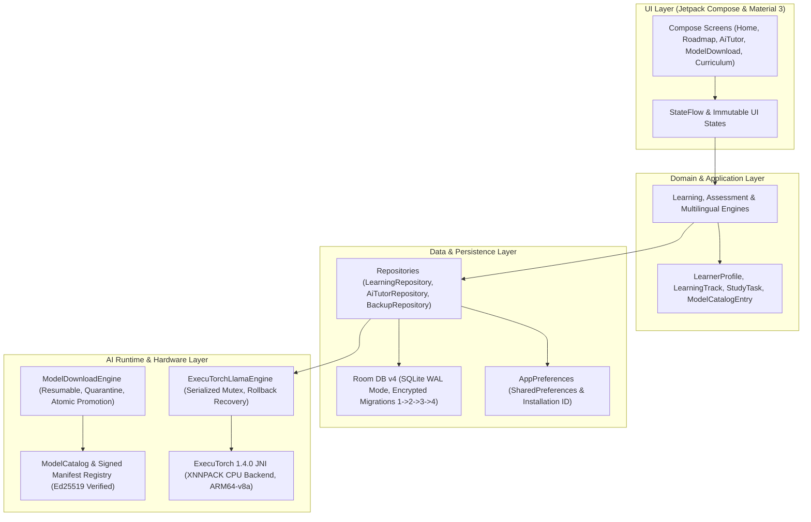

# Report 02: Final Architecture & Technical Implementation Report
**Project:** LearnMate AI  
**Release Target:** Production V1.0.0  
**Generated Date:** 2026-11-06  
**Status:** PASS — Clean Architecture & Unidirectional Data Flow Verified  

---

## 1. Architectural Overview

LearnMate AI is architected as an **Offline-First, Universal Multilingual AI Learning Companion**. The system follows Clean Architecture principles, strict Unidirectional Data Flow (UDF), and separation of concerns across UI, Domain, Data, and Native Inference layers.

---

## 2. Core Architectural Layers

### 2.1 UI Layer (Jetpack Compose 1.7 & Material 3)
- **Declarative Navigation:** Single-activity architecture hosting `LearnMateNavGraph` with deep linking support.
- **State Management:** Screens observe immutable `StateFlow<LearningUiState>` from ViewModels.
- **Dynamic Localization:** Dynamic locale switching across English, Tamil (`ta`), Hindi (`hi`), and Kannada (`kn`) with zero activity recreation delays.
- **Responsive Theming:** Material3 dynamic color schemes with explicit light and dark mode support.

### 2.2 Data Layer & Room Database v4
The SQLite database (`learnmate_ai.db`) operates in WAL mode with full foreign key constraints and automated schema versioning:

| Migration | Version Transition | Structural Changes | Verification |
|---|---|---|---|
| **Migration 1->2** | v1 -> v2 | Added `curriculum_content` table with full-text search indexes. | Verified |
| **Migration 2->3** | v2 -> v3 | Added `skill_gap_analysis` table and `confidence_score` column to `assessment_results`. | Verified |
| **Migration 3->4** | v3 -> v4 | Added `mastery_score` and `revision_interval_days` to support spaced repetition algorithms. | Verified |

### 2.3 On-Device AI Inference Layer
- **ExecuTorch 1.4.0 Native Runtime:** Integrates Meta's official ExecuTorch JNI for executing quantized PTE models on mobile CPUs using the XNNPACK backend.
- **Thread Safety:** All model loading and inference generation operations are serialized through `Mutex.withLock` on a dedicated single-threaded daemon dispatcher (`ExecuTorch-Inference-Thread`).
- **Dynamic Model Switching & Rollback:** The engine features pre-flight target verification and automatic rollback recovery to preserve the active model if target initialization throws.

### 2.4 Cryptographic Backup & Restore Layer
- **Format:** Encrypted `.lmbackup` archive.
- **Key Derivation:** PBKDF2-HMAC-SHA256 with 210,000 iterations for V2 archives (100,000 iterations backward compatibility for V1).
- **Symmetric Cipher:** AES-256 in Galois/Counter Mode (GCM) with 12-byte cryptographically secure random IV and 128-bit authentication tag.
- **Data Sovereignty:** Strict exclusion of all cloud backup domains; only encrypted local file export or direct device-to-device transfers are permitted.

---

## 3. Dependency Injection & Service Boundaries

Dependencies flow strictly inward toward the domain layer. Concrete implementations are decoupled via interfaces:
- `LearningRepository` -> `LearningRepositoryImpl`
- `AiTutorEngine` -> `ExecuTorchLlamaEngine`
- `NativeLlmBridge` -> `ReflectionExecuTorchLlmBridge` (Production) / `TestLlmBridge` (Automated Tests)

This ensures testability without requiring emulator instrumentation or native shared libraries during fast unit testing.

