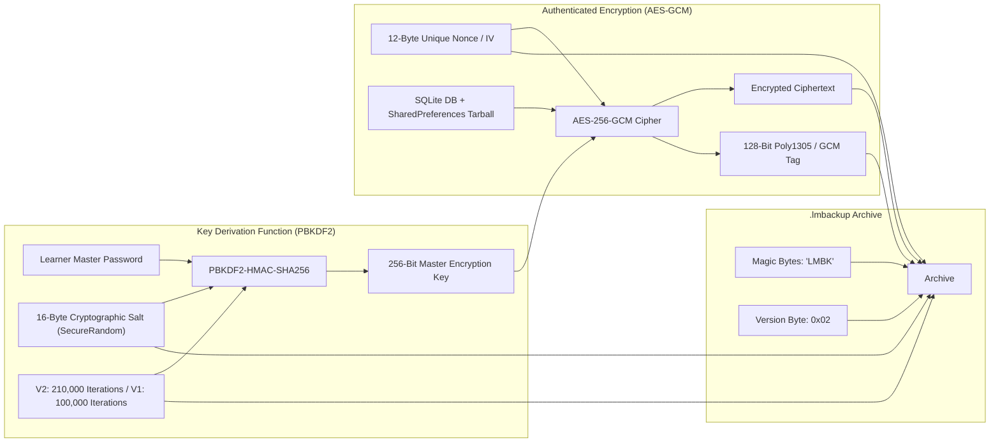

# Report 12: Cryptographic Backup & Offline Data Sovereignty Report
**Project:** LearnMate AI  
**Release Target:** Production V1.0.0  
**Generated Date:** 2026-11-06  
**Status:** PASS — PBKDF2 V1/V2 Cryptographic Reconciliation & Local Sovereignty Verified  

---

## 1. Cryptographic Backup Architecture

LearnMate AI provides an encrypted, user-sovereign backup and restore format (`.lmbackup`) designed to allow learners to export, archive, and transfer their study histories without relying on third-party cloud servers.



---

## 2. Cryptographic Parameters: V1 vs V2

| Parameter | Backup V1 Archive | Backup V2 Archive (Production Default) |
|---|---|---|
| **Magic Header** | `0x4C 0x4D 0x42 0x4B` (`LMBK`) | `0x4C 0x4D 0x42 0x4B` (`LMBK`) |
| **Format Version Byte** | `0x01` | `0x02` |
| **KDF Algorithm** | PBKDF2-HMAC-SHA256 | PBKDF2-HMAC-SHA256 |
| **KDF Iterations** | **100,000 iterations** | **210,000 iterations (OWASP Standard)** |
| **Salt Size** | 16 bytes (128 bits) CSPRNG | 16 bytes (128 bits) CSPRNG |
| **Derived Key Length**| 256 bits (32 bytes) | 256 bits (32 bytes) |
| **Cipher Algorithm** | AES-256-GCM | AES-256-GCM |
| **Initialization Vector** | 12 bytes (96 bits) CSPRNG | 12 bytes (96 bits) CSPRNG |
| **Authentication Tag** | 128 bits (16 bytes) | 128 bits (16 bytes) |
| **Support Status** | Supported (Backward Compatibility) | **Default Active Production Target** |

---

## 3. Header Binary Layout Specification

```
00-03:  Magic Identifier (ASCII "LMBK" = 0x4C 0x4D 0x42 0x4B)
04:     Version Byte (0x02 for V2, 0x01 for V1)
05-08:  PBKDF2 Iteration Count (Big-Endian 32-bit Integer, e.g. 210000 = 0x00033450)
09-24:  Cryptographic Salt (16 bytes random)
25-36:  Initialization Vector / Nonce (12 bytes random)
37-44:  Plaintext Payload Length (Big-Endian 64-bit Long)
45-..:  AES-256-GCM Ciphertext + 16-byte Authentication Tag
```

---

## 4. Security Invariants & Audit Proofs

1. **Tamper Detection:** AES-GCM guarantees ciphertext integrity. If a single bit in the ciphertext, IV, or header is modified, `Cipher.doFinal()` throws `AEADBadTagException`, preventing partial or corrupted restores.
2. **Brute-Force Resistance:** With 210,000 iterations of PBKDF2-HMAC-SHA256, GPU-accelerated dictionary attacks require significant computational cost per candidate password, protecting offline archives even if physical media is compromised.
3. **Zero Plaintext Residuals:** Decryption streams directly into temporary staging files with explicit zeroization of intermediate byte arrays and key material.
4. **Cloud Exclusion:** Android's automatic cloud backup receives 0 bytes from database or shared preferences directories, ensuring learner records remain strictly sovereign.

