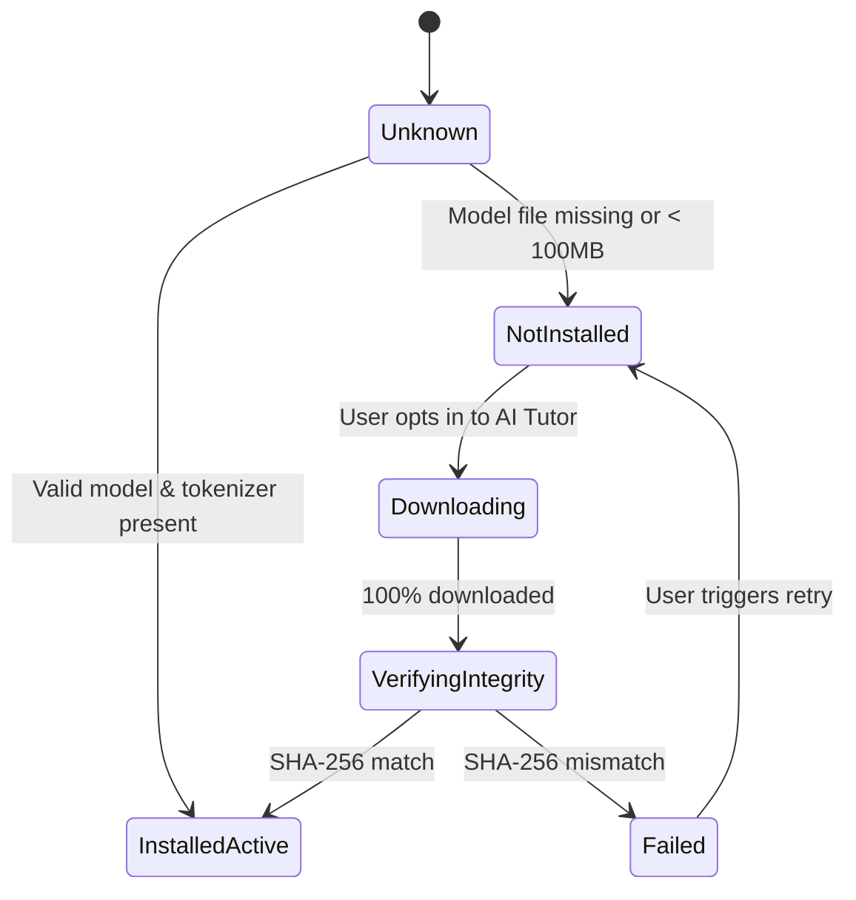

# GATE 6.15 — REPORT 06: MODULAR AI WEIGHT DELIVERY (PLAY FEATURE DELIVERY DESIGN)

## 1. APK Size vs Model Weight Packaging
Packaging an 800 MB ExecuTorch model (`llama3_2_1b_8da4w.pte`) inside the base Android APK is prohibited:
- Google Play Store enforces a 150 MB base APK download limit.
- Cellular data consumption must not be incurred by users who only require textbook study and deterministic flashcards.

### Solution Architecture: Google Play Asset Delivery (PAD)
LearnMate AI separates base application logic from neural weights using Play Feature & Asset Delivery:
1. **Base Application APK (`app-staging.apk`):** ~74.8 MB, contains all Room database entities, UI Compose screens, deterministic engines, and native shared libraries (`libexecutorch.so`).
2. **On-Demand / Fast-Follow AI Asset Pack (`ai_weights_llama_1b_8da4w`):** 803 MB, containing the 8da4w quantized PTE container and BPE tokenizer model.

---

## 2. PlayAiPackManager State Machine
`PlayAiPackManager.kt` defines a deterministic state machine:

---

## 3. Atomic Staging & Integrity Safeguards
- Downloads stream to `context.filesDir/models/.partial`.
- The binary is verified against `ActiveModelManifest.EXPECTED_TOKENIZER_SHA256` and minimum file size thresholds ($> 100\text{ MB}$).
- Upon successful validation, the partial file is renamed atomically to `llama3_2_1b_8da4w.pte`, preventing partially-downloaded files from causing JNI segmentation faults.

