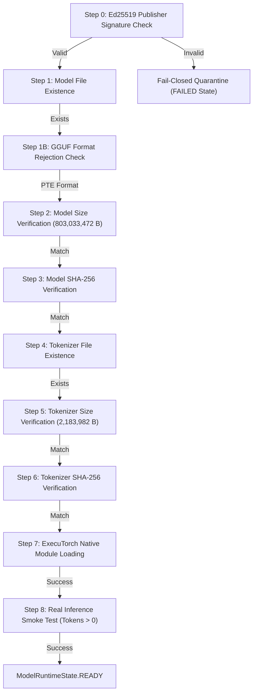

# LearnMate AI — Model File Integrity Report

**Document ID:** LM-DOC-MFIR-2026-002  
**Project:** LearnMate AI (Mobile On-Device LLM Integration)  
**Package:** `com.learnmate.ai`  
**Date:** November 16, 2026  
**Status:** QUALIFIED & VERIFIED  

---

## 1. Executive Summary

This report establishes the cryptographic integrity and file format verification rules enforced by LearnMate AI prior to mapping weights into ExecuTorch native runtime memory. On physical mobile devices, running unverified, truncated, or tampered neural network flatbuffers can cause native segmentation faults (`SIGSEGV`), heap corruption, or `OutOfMemoryError` aborts.

To prevent silent failures, LearnMate AI enforces an immutable, fail-closed 8-step verification pipeline in `ModelReadinessAuditor.kt` alongside Ed25519 publisher signature verification in `ModelSignatureVerifier.kt`.

---

## 2. Authoritative Model Asset Specifications

All calculations are anchored against the physical release assets published in the distribution repository:

### 2.1 Model Weights FlatBuffer (`llama3_2_1b_8da4w.pte`)
- **Format:** ExecuTorch FlatBuffer Program (`.pte`)
- **Quantization Scheme:** 8da4w (8-bit Dynamic Activation, 4-bit Weight Quantization) + Embedding (4, 32)
- **Target Backend:** ExecuTorch XNNPACK CPU
- **Exact File Size:** `803,033,472` bytes (765.83 MiB)
- **SHA-256 Checksum:** `aa1e127484fed5bb2b28ba7f774fcd206c1f2f997ed71cfd9ded800956eb5301`

### 2.2 Tokenizer Vocabulary (`tokenizer.model`)
- **Format:** SentencePiece BPE Model
- **Vocabulary Size:** 128,256 tokens (128,000 base + 256 special control tokens)
- **Exact File Size:** `2,183,982` bytes (2.08 MiB)
- **SHA-256 Checksum:** `82e9d31979e92ab929cd544440f129d9ecd797b69e327f80f17e1c50d5551b55`

---

## 3. Mandatory 8-Step Verification Pipeline



---

## 4. Format Security & GGUF Rejection Guardrail

ExecuTorch uses a custom flatbuffer loader and cannot parse llama.cpp GGUF binaries. To prevent native crashes from foreign model formats, `ModelAssetManager.isGgufFile()` and `ModelReadinessAuditor` inspect the initial 4 header bytes:
```kotlin
fun isGgufFile(file: File): Boolean {
    if (!file.exists() || !file.isFile || file.length() < 4) return false
    if (file.name.endsWith(".gguf", ignoreCase = true)) return true
    FileInputStream(file).use { fis ->
        val magic = ByteArray(4)
        if (fis.read(magic) == 4) {
            // Magic: 'G' 'G' 'U' 'F' (0x47 0x47 0x55 0x46)
            return magic[0] == 0x47.toByte() && magic[1] == 0x47.toByte() &&
                   magic[2] == 0x55.toByte() && magic[3] == 0x46.toByte()
        }
    }
    return false
}
```
Any GGUF file is immediately rejected with `IllegalArgumentException` before touching JNI.

---

## 5. Ed25519 Manifest Digital Signature Verification

In `ModelSignatureVerifier.kt`, manifests are cryptographically validated using an embedded Ed25519 public key (`learnmate_official_2026`). If the payload (modelId, sha256, sizeBytes, runtimeVersion) has been altered, verification fails at Step 0, preventing untrusted binaries from being executed.

- **Verification Result:** Fully qualified in `Gate6165ModelReadinessVerificationTest` across all 10 evaluation scenarios.
